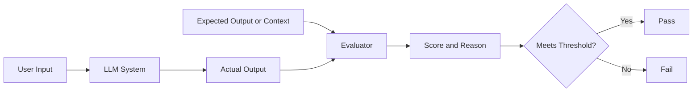
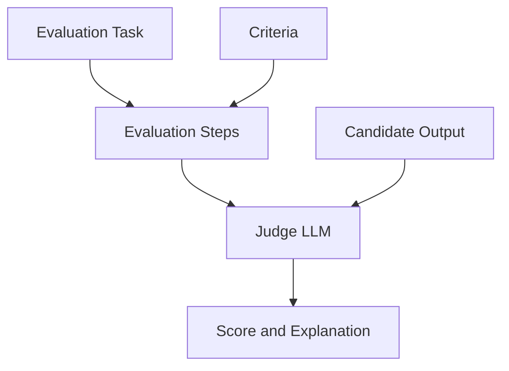
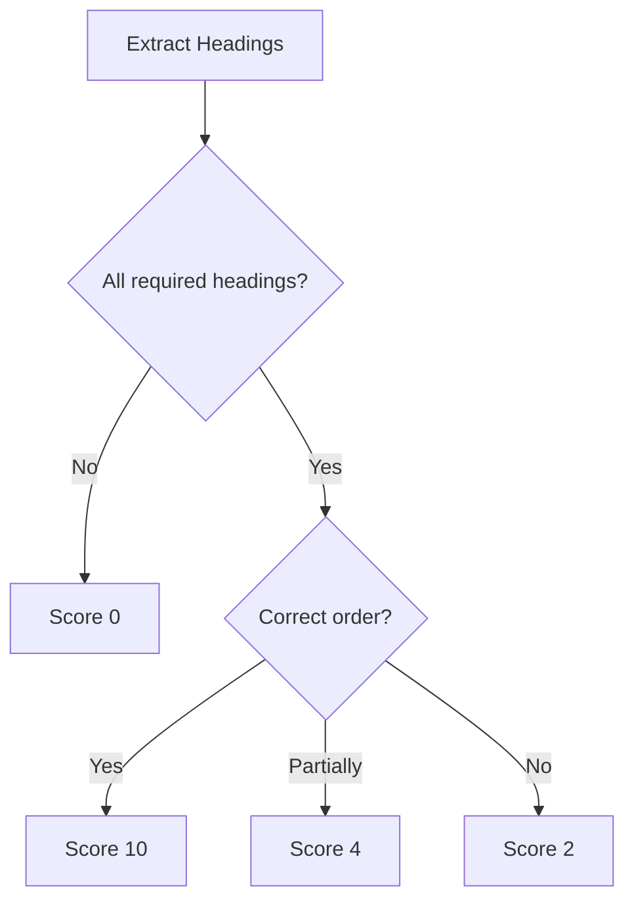
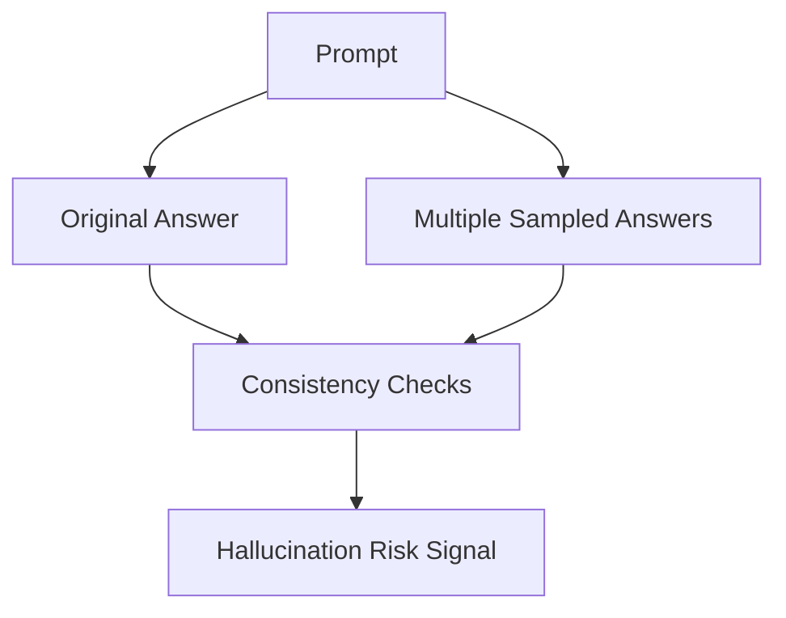
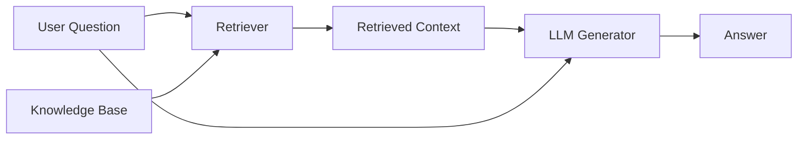
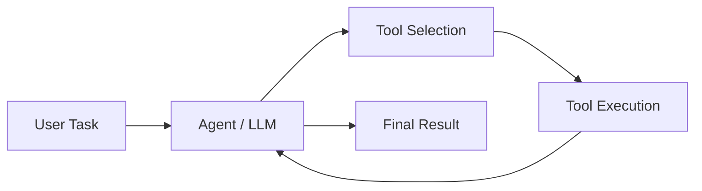
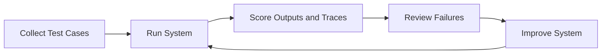

# LLM Evaluation: Complete Learning Notes

> A beginner-to-advanced handbook on evaluating large language models, retrieval-augmented generation (RAG), AI agents, and conversational systems.
>
> **Primary reference:** Jeffrey Ip, *LLM Evaluation Metrics: The Ultimate LLM Evaluation Guide* (Confident AI / DeepEval; reference supplied by the reader, dated October 15, 2026).
>
> **Scope note:** The metric taxonomy and DeepEval-oriented concepts below follow the supplied reference. Sections explicitly marked **Additional engineering guidance** extend beyond that article. Illustrative formulas simplify implementation details and should not be assumed to reproduce a library's exact scoring algorithm. Library APIs change; check the installed version's documentation before running examples.

## Table of Contents

1. [What is LLM evaluation?](#1-what-is-llm-evaluation)
2. [Core terminology and test cases](#2-core-terminology-and-test-cases)
3. [What makes a good metric?](#3-what-makes-a-good-metric)
4. [Families of evaluation scorers](#4-families-of-evaluation-scorers)
5. [Statistical scorers](#5-statistical-scorers)
6. [Model-based scorers](#6-model-based-scorers)
7. [LLM-as-a-Judge](#7-llm-as-a-judge)
8. [G-Eval](#8-g-eval)
9. [DAG evaluation](#9-dag-evaluation)
10. [Prometheus](#10-prometheus)
11. [QAG scoring](#11-qag-scoring)
12. [GPTScore and SelfCheckGPT](#12-gptscore-and-selfcheckgpt)
13. [Selecting the right metrics](#13-selecting-the-right-metrics)
14. [RAG evaluation](#14-rag-evaluation)
15. [AI agent evaluation](#15-ai-agent-evaluation)
16. [Multi-turn conversation evaluation](#16-multi-turn-conversation-evaluation)
17. [Foundational model evaluation](#17-foundational-model-evaluation)
18. [Task-specific evaluation](#18-task-specific-evaluation)
19. [Practical DeepEval examples](#19-practical-deepeval-examples)
20. [Additional engineering guidance: production evaluation](#20-additional-engineering-guidance-production-evaluation)
21. [Worked evaluation walkthrough](#21-worked-evaluation-walkthrough)
22. [Common mistakes and troubleshooting](#22-common-mistakes-and-troubleshooting)
23. [Learning roadmap](#23-learning-roadmap)
24. [Glossary](#24-glossary)
25. [References and further reading](#25-references-and-further-reading)

---

## 1. What is LLM evaluation?

**LLM evaluation (LLM evals)** is the process of measuring whether a language model or an application built around it produces outputs and actions that meet defined quality requirements.

Evaluation asks questions such as:

- Did the answer address the user's question?
- Is the answer factually supported by the available evidence?
- Did the system follow its instructions?
- Did the retriever find useful documents?
- Did an agent select the right tools and complete the task?
- Did a chatbot remain consistent across multiple turns?
- Does the model produce toxic or biased responses?

### 1.1 Model evaluation versus system evaluation

**Model evaluation** focuses on a model's outputs or behavior, such as correctness, hallucination, toxicity, and bias.

**System evaluation** examines the whole application: prompts, retrieval, tools, orchestration, model outputs, and multi-turn state. A good underlying model can still power a poor application if retrieval or tool execution fails.

### 1.2 The basic evaluation pipeline



An evaluator receives a **test case**, applies a **metric** using a **scorer**, and returns a result. For example, a faithfulness evaluator may examine a generated answer against retrieved passages and report a score and an explanation.

### 1.3 Why evaluation is difficult

Natural language allows multiple equally valid answers. A correct response may use different wording than a reference; a fluent response may contain false facts; an agent may reach the correct answer through an unsafe or inefficient process. Consequently, one number rarely captures every relevant aspect of quality.

---

## 2. Core terminology and test cases

| Term | Meaning |
|---|---|
| Input | User request or task presented to the system |
| Actual output | Response actually generated by the system |
| Expected output | Reference or ideal response, when available |
| Context | Reference information provided to assess an answer |
| Retrieval context | Documents or passages actually retrieved by a RAG system |
| Golden | A curated example with an input and possibly a reference answer or expected behavior |
| Dataset | Collection of evaluation examples |
| Metric | Quality dimension being measured, e.g. faithfulness |
| Scorer | Method that computes the metric's score |
| Judge | Model used to evaluate an output |
| Rubric | Explicit rules describing how a response should be scored |
| Threshold | Cutoff for passing an evaluation |
| Trace | Recorded sequence of agent/model/tool operations |
| Span | Individual operation within a trace |
| Single-turn | One user interaction and its response or workflow |
| Multi-turn | Conversation whose evaluation depends on preceding turns |

**Example test case**

```json
{
  "input": "What is the return policy?",
  "actual_output": "Returns are accepted within 30 days.",
  "expected_output": "Customers can return items within 30 days of delivery.",
  "retrieval_context": [
    "Customers may return eligible products within 30 days of delivery."
  ]
}
```

This example supports multiple evaluations. **Relevancy** checks whether the answer addresses the policy question. **Faithfulness** checks whether the answer is supported by the retrieved passage. **Correctness** can compare the response against the expected answer.

**Important:** An expected answer and a retrieved document are not interchangeable. A RAG answer can be faithful to retrieved documents that are themselves outdated or wrong. Faithfulness does not automatically establish real-world truth.

---

## 3. What makes a good metric?

The reference emphasizes three properties:

1. **Quantitative:** Produces a measurable result that can be compared with a threshold and tracked over time.
2. **Reliable:** Produces sufficiently consistent scores for comparable cases; evaluation should not fluctuate unpredictably.
3. **Accurate:** Captures the quality that human reviewers actually care about.

These properties can conflict. Exact string matching is consistent but may reject valid paraphrases. LLM judges understand semantics better but can vary across runs.

### 3.1 Metric versus scorer

A **metric** specifies *what* is measured: for example, answer relevancy. A **scorer** specifies *how* the score is calculated: for example, a question-answering judge, embedding similarity, or a custom rubric.

### 3.2 Thresholds

For a metric where larger values are better, a simple pass rule is:

```text
pass = score >= threshold
```

Not every metric follows that direction. For toxicity or error-rate metrics, **lower may be better**. Check the metric's semantics before choosing a threshold.

### 3.3 Component-level versus end-to-end evaluation

- **End-to-end:** Did the application solve the user's problem?
- **Component-level:** Which stage succeeded or failed—retrieval, planning, tool selection, or generation?

Both are useful. End-to-end metrics show user-visible outcomes; component metrics explain why those outcomes occurred.

---

## 4. Families of evaluation scorers

The reference distinguishes statistical, model-based, and hybrid approaches.

| Family | Examples | Primary strength | Primary limitation |
|---|---|---|---|
| Statistical | BLEU, ROUGE, METEOR, edit distance | Reproducible and inexpensive | Limited semantic understanding |
| NLP model-based | NLI, BLEURT | Captures more than literal overlap | Model and domain limitations |
| Embedding-based | BERTScore, MoverScore | Detects semantic similarity | Similarity does not guarantee factuality |
| LLM-based | G-Eval, DAG, Prometheus | Flexible natural-language judgments | Cost, bias, variability |
| Hybrid / structured | QAG | Constrains judgments into discrete decisions | Depends on claim extraction and judge accuracy |
| Probability / sampling | GPTScore, SelfCheckGPT | Useful specialized signals | Model probabilities or repeated generations may be required |

**Key lesson:** Choose the scorer that matches the evaluation criterion. Exact matching is excellent for an exact tool name; it is often inappropriate for open-ended explanations.

---

## 5. Statistical scorers

### 5.1 BLEU

**BLEU (Bilingual Evaluation Understudy)** measures n-gram precision between a candidate answer and one or more references, with a brevity penalty. It originated in machine translation evaluation.

Simplified conceptual form:

```text
BLEU = brevity_penalty × geometric_mean(modified_n_gram_precisions)
```

BLEU can penalize valid paraphrases. For example, “The device is inexpensive” and “The product costs very little” may have similar meaning but few shared words.

### 5.2 ROUGE

**ROUGE (Recall-Oriented Understudy for Gisting Evaluation)** compares overlap with reference text, commonly for summarization. ROUGE-N focuses on n-gram overlap; other variants include longest common subsequence approaches.

Simplified ROUGE-N recall:

```text
ROUGE-N recall = matched_reference_n_grams / total_reference_n_grams
```

It can reward word overlap even when a summary misrepresents meaning.

### 5.3 METEOR

**METEOR (Metric for Evaluation of Translation with Explicit Ordering)** combines precision, recall, linguistic matching such as synonyms, and a word-order penalty. It is more flexible than raw n-gram overlap, but still not a full factual or reasoning evaluator.

### 5.4 Levenshtein distance

The minimum number of character insertions, deletions, and substitutions needed to transform one string into another.

```text
kitten → sitting = 3 edits
```

Useful for spelling correction and exact-format tasks, not for assessing the reasoning quality of an essay.

### When statistical scorers are appropriate

Use them when wording, token overlap, or exact format matters. Avoid treating them as comprehensive quality scores for complex LLM answers.

---

## 6. Model-based scorers

### 6.1 Natural Language Inference (NLI)

NLI models assess the relationship between a premise and a hypothesis:

- **Entailment:** The premise supports the hypothesis.
- **Contradiction:** The premise conflicts with the hypothesis.
- **Neutral:** The premise does not establish either conclusion.

Example:

```text
Premise: The store closes at 8 PM.
Hypothesis: The store is open until 9 PM.
Result: Contradiction
```

NLI can help with consistency and groundedness checks, although long documents and domain shifts may reduce accuracy.

### 6.2 BLEURT

**BLEURT** uses pretrained transformer representations and learned quality prediction to assess generated text relative to references. Its usefulness depends partly on training-data coverage.

### 6.3 BERTScore

BERTScore compares contextual token embeddings rather than just matching identical words. Similar tokens receive credit even when the surface wording differs.

Conceptually:

```text
Reference tokens → contextual embeddings
Candidate tokens → contextual embeddings
             ↓
     token similarity matching
             ↓
      precision / recall / F1
```

Semantic similarity is not the same as factual agreement: “approved” and “rejected” can appear in otherwise very similar sentences.

### 6.4 MoverScore

MoverScore uses contextual embeddings and a transport-distance idea related to **Earth Mover's Distance** to compare how meaning is distributed across two texts.

**Takeaway:** Embedding metrics are useful signals, but do not replace evidence-based checks when factual accuracy matters.

---

## 7. LLM-as-a-Judge

**LLM-as-a-Judge** uses a language model to assess another model's output according to explicit criteria. The evaluator may return a numeric score, a categorical verdict, a rationale, or all three.

### Example rubric

```text
Task: Evaluate whether the assistant's answer is relevant.
User question: How can I reset my password?
Assistant answer: Go to Settings > Security > Reset Password.

Rubric:
1 = Does not address the question.
3 = Partially addresses the question.
5 = Directly answers the question with actionable guidance.

Return a score and a brief explanation.
```

### Advantages

- Can judge meaning rather than only matching strings.
- Can assess custom criteria such as helpfulness, tone, or clarity.
- Can provide explanations to help developers investigate failures.

### Limitations

- The judge may be inconsistent.
- A judge can favor particular wording, answer length, or model styles.
- The judge may make its own factual mistakes.
- Long inputs increase cost and can complicate judgment.

**Additional engineering guidance:** Calibrate judges against human-labeled examples, use explicit rubrics, inspect disagreement cases, and avoid treating a judge's rationale as independent proof of correctness.

---

## 8. G-Eval

**G-Eval** is an LLM-based evaluation framework discussed in the reference in connection with the paper *NLG Evaluation using GPT-4 with Better Human Alignment*.

It is particularly suited to **subjective or nuanced criteria**, such as coherence and helpfulness.

### 8.1 Conceptual process

1. Specify the evaluation task.
2. Define the evaluation criterion.
3. Generate or provide evaluation steps.
4. Evaluate the candidate using those steps.
5. Produce a score, potentially normalized using score-token probabilities where available.



The original framework discusses probability-weighted scoring to reduce coarse-score effects; implementations may differ.

### 8.2 Example: coherence

```python
from deepeval.metrics import GEval
from deepeval.test_case import LLMTestCase, LLMTestCaseParams

test_case = LLMTestCase(
    input="Explain photosynthesis in simple terms.",
    actual_output="Plants use sunlight to help make food from water and carbon dioxide."
)

metric = GEval(
    name="Coherence",
    criteria="Evaluate whether the explanation is logically connected and easy to follow.",
    evaluation_params=[LLMTestCaseParams.ACTUAL_OUTPUT],
)

metric.measure(test_case)
print(metric.score)
print(metric.reason)
```

This follows the reference's DeepEval pattern. It requires a supported judge-model configuration.

### 8.3 Best use cases

- Coherence
- Helpfulness
- Brand voice
- Writing quality
- Domain-specific rubric assessment

### 8.4 Limitations

G-Eval remains sensitive to judge choice, rubric wording, and sampling. A high score is not proof of factual correctness unless the judge was given adequate reference evidence.

---

## 9. DAG evaluation

A **Directed Acyclic Graph (DAG)** evaluator uses a structured set of decisions. The reference describes DeepEval's DAG metric as an LLM-powered decision graph with judgment nodes and explicit verdicts or scores.

### 9.1 Why use a DAG?

Suppose a report must include three headings in the correct order. A generic subjective rating is less useful than checking explicit conditions.



### 9.2 Core node concepts

- **TaskNode:** Extracts or transforms information for later decisions.
- **BinaryJudgementNode:** Makes a yes/no judgment.
- **NonBinaryJudgementNode:** Chooses among several verdicts.
- **VerdictNode:** Produces a final score or directs the evaluation onward.

### 9.3 G-Eval versus DAG

| G-Eval | DAG |
|---|---|
| Suited to subjective quality | Suited to explicit conditional rules |
| Rubric produces a graded judgment | Decision paths encode evaluation logic |
| Flexible and concise to define | More structured and auditable |
| May vary across repeated judgments | Score mapping is explicit, though LLM node judgments can still vary |

**Important:** A DAG is not inherently fully deterministic when its decision nodes rely on probabilistic LLM judgments. The final score for a fixed path may be deterministic; the selected path may not be.

---

## 10. Prometheus

**Prometheus** is a family of open evaluation-oriented language-model approaches discussed in the reference as an alternative to relying entirely on proprietary judges.

The supplied article describes a Prometheus model fine-tuned on feedback data and designed to assess outputs using an explicit rubric and reference materials.

### Key differences from G-Eval in the reference

- G-Eval describes an evaluation procedure; Prometheus is a model trained for evaluation.
- Prometheus uses a supplied scoring rubric rather than necessarily generating evaluation steps.
- Reference answers and examples play an important role in its judgments.

### When to consider it

When an open model and local or self-hosted evaluation are priorities, an evaluation-tuned judge can be useful. Judge quality must still be measured on the target domain; do not assume one published benchmark result generalizes to every task.

---

## 11. QAG scoring

**QAG (Question Answer Generation) scoring** converts broad judgments into structured, close-ended questions, such as yes/no checks.

### 11.1 Example: faithfulness

Generated answer:

```text
The store closes at 8 PM and offers free parking.
```

Retrieved passage:

```text
The store closes at 8 PM. Parking is available for a fee.
```

Extracted claims:

1. The store closes at 8 PM.
2. Parking is free.

Judge each claim against the passage:

| Claim | Supported? |
|---|---|
| Closes at 8 PM | Yes |
| Free parking | No |

An **illustrative** supported-claim ratio is:

```text
faithfulness = supported_claims / total_evaluated_claims
             = 1 / 2
             = 0.50
```

### 11.2 Handling unknown claims

The reference also discusses a three-way `yes / no / idk` decision and describes an implementation that counts `yes` and `idk` as truthful for its faithfulness calculation. This is a **specific design choice**, not a universal definition of faithfulness.

**Additional engineering guidance:** For stricter evidence-grounding, distinguish **supported**, **contradicted**, and **not established**. Counting unsupported claims as correct can inflate a groundedness score. Decide how abstentions and missing evidence are handled before interpreting results.

### 11.3 Strengths and weaknesses

QAG can make scoring more structured and interpretable. However, missed claims, poor question generation, and incorrect yes/no decisions can distort the final score.

---

## 12. GPTScore and SelfCheckGPT

### 12.1 GPTScore

GPTScore uses the conditional probability of generating target text under a task- and aspect-specific prompt as an evaluation signal. It is not simply a judge directly assigning a numeric quality rating.

It can be used for criteria where model likelihood is informative, but depends on probability access and the design of the prompt.

### 12.2 SelfCheckGPT

SelfCheckGPT is a sampling-based hallucination-detection method. It generates multiple responses to the same prompt and checks whether the statements in the original answer remain consistent across samples.



**Assumption:** Facts known reliably by the model are more likely to recur consistently; invented details may vary.

**Critical limitation:** Repeated agreement is not independent verification. A model can confidently repeat the same falsehood across samples. Treat the result as a risk signal, not a guarantee of truth.

---

## 13. Selecting the right metrics

The reference recommends a pragmatic **five-metric rule of thumb**:

- Approximately **1–2 task-specific metrics** using G-Eval or DAG.
- Approximately **2–3 architecture-specific metrics** for RAG, agents, or conversations.

This is a starting point, not a hard scientific limit. The correct number depends on failure modes, system complexity, and evaluation cost.

### 13.1 Decision process

1. Identify whether the system is single-turn or multi-turn.
2. Identify its architecture: plain LLM, RAG, agent, or hybrid.
3. Define the user-visible success condition.
4. Identify the most consequential failure modes.
5. Choose a small number of metrics that distinguish those failures.
6. Validate scores against examples reviewed by people.
7. Revise metrics as the product changes.

### 13.2 Example metric bundles

| Application | Suggested starting metrics |
|---|---|
| RAG FAQ assistant | Faithfulness, answer relevancy, contextual relevancy, helpfulness |
| Search-augmented research assistant | Faithfulness, contextual precision, contextual recall, citation quality (custom) |
| Tool-using support agent | Task completion, tool correctness, argument correctness, helpfulness |
| Summarizer | Summarization, factual consistency, instruction compliance |
| Multi-turn RAG chatbot | Turn faithfulness, turn relevancy, turn contextual recall, conversation-specific success |

---

## 14. RAG evaluation

**Retrieval-Augmented Generation (RAG)** combines a retriever that finds context with a generator that writes an answer using the context and the user's question.



### 14.1 Why evaluate retrieval and generation separately?

An answer can fail because relevant information was not retrieved, because irrelevant information was ranked too highly, or because the generator ignored or misrepresented good evidence.

### 14.2 The five RAG metrics in the reference

| Metric | Stage | What it measures | Reference answer needed? |
|---|---|---|---|
| Faithfulness | Generator | Whether claims align with retrieved context | Typically no |
| Answer relevancy | Generator | Whether the answer addresses the question | Typically no |
| Contextual precision | Retriever | Whether useful retrieved items rank above irrelevant items | In the shown DeepEval example, yes |
| Contextual recall | Retriever | Whether retrieved material covers the expected answer | In the shown DeepEval example, yes |
| Contextual relevancy | Retriever | Whether retrieved passages are relevant to the question | Typically no |

### 14.3 Faithfulness

**Question:** Is the answer supported by the retrieved evidence?

```text
Question: When does the shop close?
Retrieved text: The shop closes at 8 PM.
Answer: The shop closes at 10 PM.
```

The answer is not faithful to the retrieved evidence. Faithfulness checks support, not whether the evidence itself is accurate.

### 14.4 Answer relevancy

**Question:** Does the answer respond to the user's request without unnecessary unrelated content?

```text
Question: What is the refund period?
Answer: The company was founded in 2008 and has 50 branches.
```

The answer may be factual, but it does not answer the question.

### 14.5 Contextual precision

**Question:** Are relevant passages ranked above irrelevant passages?

```text
Retrieved order:
1. Company history
2. Product advertisements
3. Refund policy
```

For a refund-policy query, the useful passage appears too late. Contextual precision assesses retrieval ranking quality.

### 14.6 Contextual recall

**Question:** Does the retrieved context contain enough information to construct the expected answer?

```text
Expected answer: Returns within 30 days require a receipt.
Retrieved context: Returns are accepted within 30 days.
```

The retrieved passage omits the receipt requirement, so coverage is incomplete.

**Illustrative intuition:**

```text
contextual_recall ≈ supported_expected_answer_claims / all_expected_answer_claims
```

The actual library implementation may use claim-level judgments rather than this exact simplified formula.

### 14.7 Contextual relevancy

**Question:** How much of the retrieved material is actually useful for the question?

A retriever that returns ten passages, nine unrelated, has poor contextual relevancy even if one passage contains the answer.

### 14.8 Diagnosing RAG failures

| Observed symptom | Investigate |
|---|---|
| Answer invents unsupported details | Faithfulness and generator prompt |
| Answer ignores the question | Answer relevancy |
| Relevant document appears low in ranking | Contextual precision |
| Important facts are missing from retrieval | Contextual recall |
| Retrieved context is mostly noise | Contextual relevancy |

---

## 15. AI agent evaluation

An **AI agent** uses a reasoning or planning component, often an LLM, to select actions such as calling tools, accessing data, or handing off work to other agents.



### 15.1 Why agent evaluation is different

The final answer alone may conceal serious failures. An agent might claim to have booked a flight without executing a booking tool, use the wrong date, or repeat expensive searches unnecessarily. Evaluating a **trace** helps reveal those failures.

### 15.2 Traces and spans

A **trace** records the complete workflow. Each **span** represents an operation, such as an LLM invocation, retrieval step, tool call, or sub-agent action.

```text
Agent trace
├── Interpret user request
├── Search flights (tool span)
├── Compare prices (LLM span)
├── Book flight (tool span)
└── Return confirmation
```

### 15.3 Six agent metrics from the reference

| Metric | Level | Core question |
|---|---|---|
| Task completion | End-to-end | Was the requested task accomplished? |
| Argument correctness | Component | Were tool arguments correct for the task? |
| Tool correctness | Component | Were the expected tools selected and called? |
| Plan quality | Component | Was the plan complete, logical, and efficient? |
| Plan adherence | Component | Did execution follow the intended plan? |
| Step efficiency | End-to-end | Were unnecessary steps avoided? |

### 15.4 Task completion

A successful-looking answer is not enough. For a booking agent, inspect whether a booking confirmation was actually returned by the tool. A task-completion evaluator may use the entire trace to assess this.

### 15.5 Argument correctness

```text
User: Find flights from Bengaluru to Delhi tomorrow.
Tool call: search_flights(origin="Delhi", destination="Bengaluru", date="tomorrow")
```

The correct tool may have been chosen, but its arguments are reversed.

### 15.6 Tool correctness

```text
Expected tools: [SearchFlights, BookFlight]
Actual tools:   [SearchFlights, BookFlight]
```

Tool correctness can use reference-based matching. Depending on configuration, an evaluator may consider tool names, order, and other constraints. This is distinct from verifying that the tool returned the right data.

### 15.7 Plan quality

Evaluate whether the proposed sequence of actions is logical, complete, and reasonably efficient.

### 15.8 Plan adherence

Evaluate whether the agent executed the plan it produced. Deviations are not automatically bad: a useful evaluator should distinguish justified adaptation from missed required steps.

### 15.9 Step efficiency

```text
Search flights → Search flights again with identical arguments → Book flight
```

The duplicate search may indicate unnecessary work, unless there was a valid reason to retry.

### 15.10 Important distinction

**Tool correctness ≠ argument correctness ≠ task completion.** An agent can pass one and fail the others.

---

## 16. Multi-turn conversation evaluation

**Multi-turn evaluation** assesses a sequence of interactions, preserving conversational history rather than scoring each message in isolation.

### Example

```text
User: I want a flight to Delhi on Friday.
Assistant: What time would you prefer?
User: Morning, and make it nonstop.
Assistant: Here are nonstop morning options for Saturday.
```

The last response may be fluent and relevant to flights, but it violates the earlier **Friday** constraint.

### 16.1 Multi-turn metrics in the reference

| Metric | What it checks |
|---|---|
| Turn faithfulness | Whether assistant turns are supported by relevant context |
| Turn relevancy | Whether assistant turns address the user in conversational context |
| Turn contextual precision | Whether retrieved passages are well-ranked across turns |
| Turn contextual recall | Whether retrieved passages cover what the conversation needs |
| Turn contextual relevancy | Whether retrieved passages remain relevant across turns |

### 16.2 Why turn history matters

A follow-up like “What about the cheaper one?” cannot be evaluated accurately without knowing the options discussed earlier. A multi-turn evaluator must resolve references, retain user constraints, and inspect how context evolves.

### 16.3 Conversation-level versus turn-level outcomes

Turn-level metrics detect local mistakes. Conversation-level evaluation asks whether the whole interaction eventually satisfied the user's objective. Both perspectives are useful.

---

## 17. Foundational model evaluation

The supplied reference discusses model-focused metrics particularly relevant to fine-tuning and behavior adjustment.

### 17.1 Hallucination

A hallucination occurs when a model presents unsupported or false content. The article discusses SelfCheckGPT-style sampling and context-based evaluation approaches.

**Important:** A hallucination metric's scoring direction may differ from a faithfulness metric. A larger hallucination score may mean **more** hallucination, not better performance.

### 17.2 Toxicity

Toxicity evaluation assesses offensive, abusive, harmful, or inappropriate language. The reference mentions classifier-based methods such as Detoxify and rubric-based approaches such as G-Eval.

A classifier can mistake quoted profanity or discussion *about* harmful language for an abusive response. Context matters.

### 17.3 Bias

Bias evaluation examines whether output reflects inappropriate or unfair treatment, including gender, social, racial, or political dimensions. The reference emphasizes how context-dependent and difficult such evaluation can be.

Rubrics should define the relevant harm and application context. A vague instruction like “score bias” is often inadequate.

### 17.4 Why no single metric is enough

A model can be polite but inaccurate, factual but unhelpful, or relevant but biased. Select metrics around the intended behavior and risks of the application.

---

## 18. Task-specific evaluation

### 18.1 Helpfulness

A helpfulness metric evaluates whether the answer assists the user in completing the intended task. The reference recommends flexible rubric-based scoring, such as G-Eval, for this subjective criterion.

### 18.2 Prompt alignment

Prompt alignment checks whether a response obeys explicit instructions.

```text
Instruction: Reply in uppercase.
Output: Please contact support.
Result: Instruction not followed.
```

The reference describes evaluating instructions individually rather than asking a judge to digest an entire long prompt at once.

### 18.3 Summarization

The reference identifies two essential dimensions:

1. **Factual alignment:** Does the summary accurately represent the source?
2. **Information inclusion:** Does it retain important source content?

The article describes a DeepEval approach using QAG-derived intermediate scores and the minimum of those scores as the final summarization score.

**Example:** A summary that contains only one correct fact may be faithful but incomplete; a summary that includes every key point plus an invented claim may be comprehensive but unfaithful.

### 18.4 Other custom criteria — additional engineering guidance

Depending on the product, custom metrics might assess citation quality, JSON schema validity, code execution correctness, privacy constraints, accessibility, domain-specific policy compliance, or successful SQL query execution. These are extensions beyond the supplied article's detailed metric list.

---

## 19. Practical DeepEval examples

The supplied article uses **DeepEval**, an open-source LLM evaluation framework. These examples are learning templates based on the referenced patterns, not guarantees of compatibility with every future version.

### 19.1 Installation

```bash
python -m pip install deepeval
```

Some model-backed metrics require a configured judge provider. For the reference's OpenAI-based setup:

```bash
export OPENAI_API_KEY="your_api_key"
```

Do not commit API keys to source control.

### 19.2 Faithfulness and answer relevancy

```python
from deepeval.test_case import LLMTestCase
from deepeval.metrics import FaithfulnessMetric, AnswerRelevancyMetric

case = LLMTestCase(
    input="When can customers return items?",
    actual_output="Customers can return eligible items within 30 days.",
    retrieval_context=[
        "Eligible items may be returned within 30 days of delivery."
    ],
)

metrics = [
    FaithfulnessMetric(threshold=0.7),
    AnswerRelevancyMetric(threshold=0.7),
]

for metric in metrics:
    metric.measure(case)
    print(type(metric).__name__, metric.score, metric.reason)
```

### 19.3 Contextual precision, recall, and relevancy

```python
from deepeval.test_case import LLMTestCase
from deepeval.metrics import (
    ContextualPrecisionMetric,
    ContextualRecallMetric,
    ContextualRelevancyMetric,
)

case = LLMTestCase(
    input="What documents are required for a return?",
    actual_output="Bring your receipt.",
    expected_output="Customers must provide proof of purchase.",
    retrieval_context=[
        "Proof of purchase is required for returns.",
        "Our company was established in 2001.",
    ],
)

for metric in [
    ContextualPrecisionMetric(threshold=0.7),
    ContextualRecallMetric(threshold=0.7),
    ContextualRelevancyMetric(threshold=0.7),
]:
    metric.measure(case)
    print(type(metric).__name__, metric.score, metric.reason)
```

### 19.4 Tool correctness

```python
from deepeval.test_case import LLMTestCase, ToolCall
from deepeval.metrics import ToolCorrectnessMetric

case = LLMTestCase(
    input="Find the latest order status.",
    actual_output="Your order is in transit.",
    tools_called=[ToolCall(name="GetOrderStatus")],
    expected_tools=[ToolCall(name="GetOrderStatus")],
)

metric = ToolCorrectnessMetric()
metric.measure(case)
print(metric.score, metric.reason)
```

### 19.5 Custom helpfulness rubric

```python
from deepeval.metrics import GEval
from deepeval.test_case import LLMTestCase, LLMTestCaseParams

case = LLMTestCase(
    input="How do I reset my password?",
    actual_output="Open Settings, choose Security, and select Reset Password.",
)

metric = GEval(
    name="Helpfulness",
    criteria=(
        "Evaluate whether the answer provides clear, relevant, "
        "actionable guidance for the user's request."
    ),
    evaluation_params=[
        LLMTestCaseParams.INPUT,
        LLMTestCaseParams.ACTUAL_OUTPUT,
    ],
)
metric.measure(case)
print(metric.score, metric.reason)
```

### 19.6 Evaluation result interpretation

For each run, record the metric name, score, threshold, pass/fail status, rationale, input, actual output, reference data, judge identity, and software version. These details are needed to investigate changes across runs.

---

## 20. Additional engineering guidance: production evaluation

> **This section expands beyond the supplied reference.** It translates the metric concepts into a practical engineering workflow.

### 20.1 Build a representative dataset

Include common user requests, difficult edge cases, ambiguous prompts, known failures, and cases where the correct behavior is to abstain. Keep test cases representative of real tasks, not just convenient examples.

### 20.2 Separate offline and online evaluation

- **Offline evaluation:** Run a curated dataset before deployment or during development.
- **Online evaluation:** Sample production traces and assess live behavior with appropriate privacy controls.

Offline tests support repeatability; online tests reveal unexpected real-world usage.

### 20.3 Human calibration

Have reviewers label a subset of examples. Compare judge scores with human judgments, examine disagreements, and revise rubrics. For consequential decisions, human review may remain necessary even when automated metrics perform well.

### 20.4 Regression testing

Use a fixed benchmark dataset to compare new versions of prompts, models, retrieval settings, or tools. Inspect **which cases changed**, not just whether the average score increased.

### 20.5 Cost, latency, and operational quality

Quality metrics alone do not describe operational performance. Track response time, token usage, API cost, error rate, tool retries, and timeouts separately. A model with a slightly higher quality score may not be the best choice for a strict latency or budget requirement.

### 20.6 Privacy and security

Avoid sending sensitive customer content to external judge services without authorization and safeguards. Minimize logged personal data, restrict access to traces, and define retention rules.

### 20.7 Suggested evaluation record

```json
{
  "test_id": "returns_001",
  "application_version": "1.0.0",
  "input": "What is the return period?",
  "actual_output": "Eligible items can be returned within 30 days.",
  "expected_output": "Eligible items can be returned within 30 days.",
  "metrics": {
    "faithfulness": 1.0,
    "answer_relevancy": 1.0
  },
  "judge_model": "example-judge",
  "passed": true
}
```

The scores above are **illustrative placeholders**, not measured outputs.

### 20.8 A practical evaluation loop



---

## 21. Worked evaluation walkthrough

Consider a customer-support RAG assistant.

**User question:** “Can I return a product after 45 days?”

**Retrieved evidence:** “Eligible products may be returned within 30 days of delivery.”

**Generated answer:** “Yes, you can return products within 60 days.”

### Step 1: Evaluate answer relevancy

The response addresses the subject of return eligibility, so it may score reasonably on relevance despite being wrong.

### Step 2: Evaluate faithfulness

The claim “within 60 days” conflicts with the retrieved 30-day policy. Faithfulness should flag this.

### Step 3: Evaluate retrieval

The relevant policy was retrieved. If it ranked highly, retrieval metrics may score well. The primary problem is generation, not retrieval.

### Step 4: Evaluate task success

The user needed an accurate eligibility answer. The system failed that objective.

### Step 5: Improve and retest

Adjust instructions to require answers grounded in retrieved policy, add the failure as a regression test, and rerun the evaluation. Do not assume a prompt change works without measuring it.

**Lesson:** Different metrics diagnose different parts of the same failure. A relevant answer can still be unfaithful and unsuccessful.

---

## 22. Common mistakes and troubleshooting

| Mistake | Why it fails | Better approach |
|---|---|---|
| Using BLEU/ROUGE for all tasks | Paraphrases receive low overlap | Add semantic or evidence-based checks |
| Using only one overall score | Hides the cause of failure | Combine task success with diagnostic metrics |
| Equating faithfulness with truth | Retrieved evidence may be wrong | Check source quality and freshness |
| Trusting a judge without calibration | Judge bias and variability | Compare against human-reviewed cases |
| Setting arbitrary thresholds | Pass/fail results become misleading | Calibrate thresholds using real examples |
| Ignoring tool traces | Agents can claim actions they never performed | Inspect tool calls and execution outcomes |
| Evaluating chat turns without history | Misses constraints and references | Use multi-turn test cases |
| Treating higher scores as always better | Toxicity and error metrics may invert direction | Check metric semantics |
| Counting unknown evidence as verified | Inflates groundedness | Distinguish support, contradiction, and unknown |
| Evaluating only easy examples | Inflated benchmark performance | Include failures, edge cases, and adversarial cases |

---

## 23. Learning roadmap

### Stage 1 — Foundations

Understand inputs, outputs, expected answers, contexts, thresholds, test cases, and the difference between model and system evaluation. Practice exact matching, BLEU, ROUGE, and semantic similarity.

### Stage 2 — LLM judges

Learn LLM-as-a-Judge, rubrics, G-Eval, DAG, and QAG. Write a custom helpfulness metric and manually inspect scores on several examples.

### Stage 3 — RAG evaluation

Build a small RAG application. Measure faithfulness, answer relevancy, contextual precision, recall, and relevancy. Deliberately introduce retrieval and generation errors to observe different failure signatures.

### Stage 4 — Agent evaluation

Build a tool-using agent. Record traces and evaluate task completion, tool selection, arguments, planning, and step efficiency.

### Stage 5 — Multi-turn evaluation

Create conversations with follow-up constraints, references to earlier answers, and evolving context. Compare turn-level and conversation-level evaluation.

### Stage 6 — Production discipline (additional guidance)

Build a versioned benchmark, calibrate judges with human labels, add regression checks, track cost and latency, and review failures after deployment.

### Practice projects

1. **Answer evaluator:** Compare relevance, coherence, and correctness across two model outputs.
2. **RAG diagnostic dashboard:** Show which failures come from retrieval versus generation.
3. **Agent trace inspector:** Display tool calls, arguments, and completion outcomes.
4. **Multi-turn benchmark:** Test whether a chatbot preserves constraints over several messages.

---

## 24. Glossary

**Answer relevancy:** How directly and usefully an answer addresses a question.

**Bias:** Inappropriate or unfair patterns in generated content or decisions.

**Contextual precision:** Whether useful retrieved material is ranked ahead of less useful material.

**Contextual recall:** Whether retrieved material covers the information needed for the expected answer.

**Contextual relevancy:** How much retrieved content is relevant to the query.

**DAG metric:** A structured graph of evaluation judgments and outcomes.

**Faithfulness:** Whether generated claims are supported by supplied evidence.

**G-Eval:** An LLM-based evaluation approach using defined criteria and evaluation steps.

**Golden:** Curated evaluation example, often with reference expectations.

**Hallucination:** Unsupported or false generated content.

**LLM-as-a-Judge:** Using a language model to assess another output.

**Metric:** A measurable quality criterion.

**Multi-turn evaluation:** Assessment of interactions using conversation history.

**NLI:** Classification of entailment, contradiction, or neutrality between texts.

**QAG:** Structured evaluation using generated questions and constrained answers.

**RAG:** Retrieval-Augmented Generation, combining retrieved evidence with generation.

**Rubric:** Scoring rules that specify what quality looks like.

**Scorer:** Algorithm or model used to calculate a metric.

**Span:** Recorded individual operation within an execution trace.

**Task completion:** Whether the agent achieved the requested objective.

**Threshold:** Score boundary for determining whether a test passes.

**Trace:** Recorded sequence of operations performed by a system or agent.

---

## 25. References and further reading

### Primary supplied reference

- Jeffrey Ip, **“LLM Evaluation Metrics: The Ultimate LLM Evaluation Guide”**, Confident AI / DeepEval, dated October 15, 2026 in the supplied text. This handbook's core metric categories, scorer descriptions, and DeepEval examples are adapted and explained from that material.

### Tools and research named in the reference

- **DeepEval** — https://github.com/confident-ai/deepeval
- **DeepEval documentation** — https://deepeval.com/docs/getting-started
- **G-Eval** — *NLG Evaluation using GPT-4 with Better Human Alignment*
- **Prometheus** — evaluation-oriented open language models and associated research
- **SelfCheckGPT** — sampling-based hallucination detection
- **BLEU, ROUGE, METEOR, BLEURT, BERTScore, MoverScore, GPTScore** — text evaluation methods discussed above

The supplied text contains references to additional articles and documentation as unexpanded phrases such as “here”; those destinations cannot be reconstructed reliably from the pasted text alone.

### Final perspective

Effective LLM evaluation is not about collecting the most scores. It is about selecting meaningful criteria, identifying the component responsible for failure, checking whether automated judgments align with human expectations, and repeatedly measuring whether changes actually improve the system.

**Start with the task, choose the failure modes, select the metrics, inspect the evidence, and iterate.**
