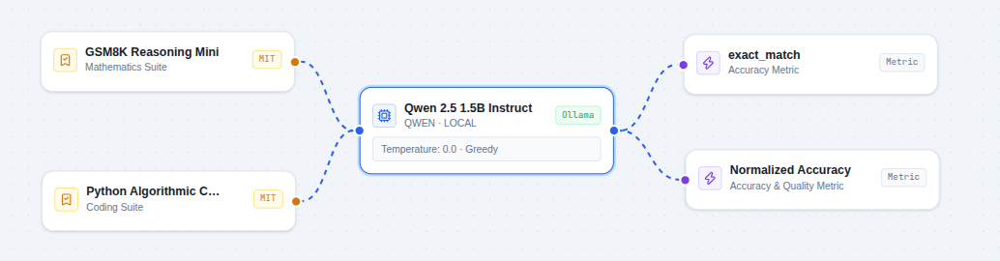
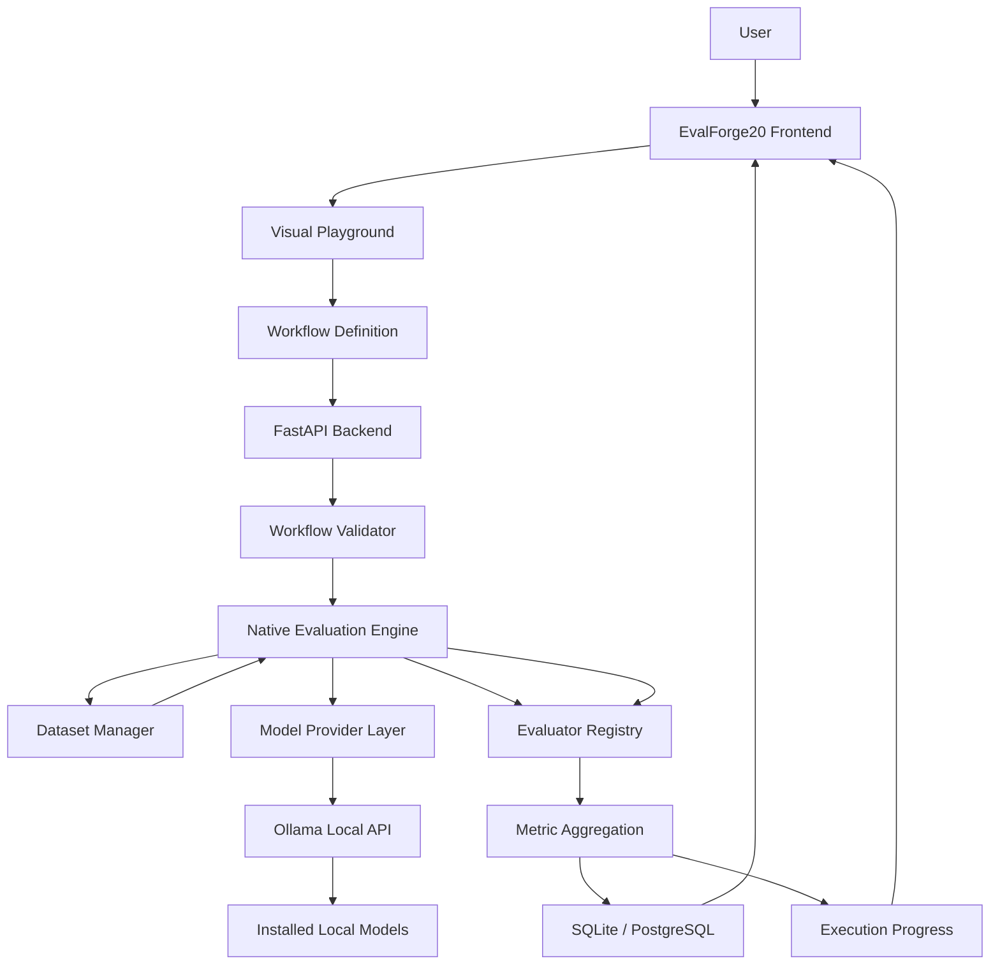
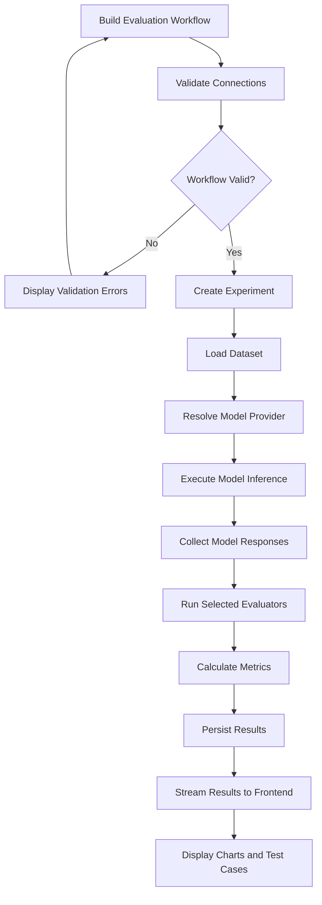
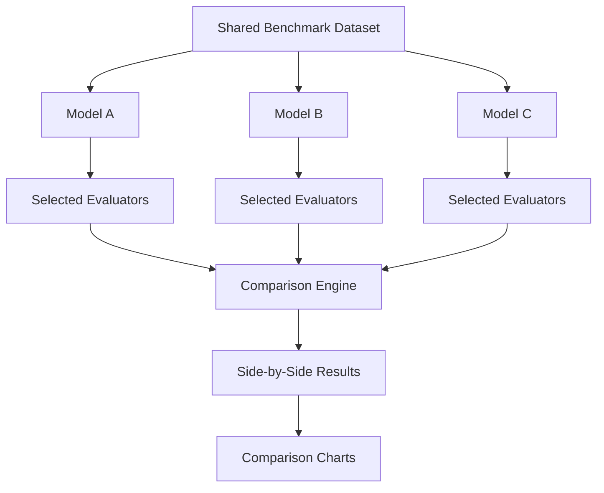

# EvalForge20

### Visual AI Model Benchmarking & Evaluation Platform

**Build. Connect. Evaluate. Compare.**

EvalForge20 is an open-source, local-first AI model evaluation platform designed to benchmark Large Language Models (LLMs) through an interactive visual playground.

Drag models, datasets and evaluation metrics onto a node-based canvas, connect them, configure your benchmark and execute evaluations using locally available models through Ollama.

Instead of writing evaluation scripts for every experiment, EvalForge20 provides a visual environment for designing, executing, inspecting and comparing AI model evaluations.

<p align="center">
  
</p>

<p align="center">
  <strong>Visual evaluation workflows. Local model execution. Measurable results.</strong>
</p>

---

## Overview

Evaluating AI models involves more than checking whether a response looks correct.

Developers need to understand model accuracy, reasoning capabilities, execution speed, resource consumption, reliability and consistency across different tasks.

EvalForge20 aims to bring these capabilities together in one visual evaluation environment.

Users can select a model, choose benchmark datasets, connect evaluation parameters and execute experiments without manually building evaluation pipelines.

### How it works

1. Select an available model from the model library.
2. Drag a benchmark dataset into the playground.
3. Drag the evaluation metrics you want to measure.
4. Connect the components using the visual canvas.
5. Configure the evaluation.
6. Execute the workflow.
7. Inspect actual model outputs and calculated evaluation results.
8. Compare different models using equivalent benchmarks.

The platform is designed around one principle:

**Evaluate only what matters to you.**

For example, connecting a model to an Accuracy evaluator should run an accuracy evaluation, not an unnecessary collection of unrelated benchmarks.

---

## Key Capabilities

### 1. Visual Evaluation Playground

An interactive, node-based workspace inspired by visual workflow editors such as n8n.

- Drag-and-drop model nodes.
- Connect datasets to models.
- Connect models to evaluation metrics.
- Configure individual nodes.
- Build single-model evaluation workflows.
- Build multi-model comparison workflows.
- Validate workflows before execution.
- Monitor execution progress.
- Inspect evaluation results.

### 2. Local Model Evaluation

EvalForge20 uses Ollama as its local model inference provider.

The intended local-first workflow includes:

- Discovering locally installed models.
- Selecting models from the available inventory.
- Executing inference locally.
- Collecting model responses.
- Measuring inference performance.
- Running benchmark datasets.
- Comparing models under equivalent conditions.

Example model families that can be evaluated when supported by the local Ollama installation:

- Llama
- Qwen
- DeepSeek
- Gemma
- Mistral
- Phi

Model availability depends on the installed Ollama models, hardware and supported model formats.

### 3. Modular Evaluation Metrics

EvalForge20 is designed around independently selectable evaluators.

| Category | Evaluation parameters |
|---|---|
| Accuracy | Exact Match, Normalized Accuracy, Classification Accuracy |
| Quality | Correctness, Relevance, Coherence, Completeness |
| Reasoning | Mathematical Accuracy, Logical Reasoning, Constraint Satisfaction |
| Coding | Unit Test Pass Rate, Code Execution Success |
| Performance | Latency, P95 Latency, Time to First Token, Tokens/sec |
| Efficiency | Token Usage, RAM, VRAM, CPU and GPU Utilization |
| Reliability | Success Rate, Failure Rate, Response Consistency |
| Safety | Toxicity, Harmful Output, Bias, Prompt Injection Resistance |
| RAG | Faithfulness, Context Precision, Context Recall |
| Agents | Task Completion, Tool Selection Accuracy, Tool-call Success |

Evaluator availability depends on the implementation, required input data and evaluation configuration.

### 4. Dataset-Based Benchmarking

Support for structured benchmark datasets enables reproducible model testing.

Planned dataset capabilities include:

- CSV uploads.
- JSON uploads.
- JSONL uploads.
- Custom test cases.
- Reference answers.
- Dataset validation.
- Dataset previews.
- Benchmark dataset management.
- Dataset version tracking.

Example dataset:

```json
{
  "input": "What is machine learning?",
  "expected_output": "Machine learning is a field of AI that enables systems to learn from data."
}
```

Datasets can contain additional fields such as context, expected labels and metadata.

### 5. Multi-Model Comparison

Compare multiple models against the same dataset and evaluation criteria.

Example:

```text
                  Benchmark Dataset
                         |
             +-----------+-----------+
             |                       |
          Model A                 Model B
             |                       |
             +-----------+-----------+
                         |
                Shared Evaluators
                         |
                Comparison Results
```

Compare models using:

- Accuracy.
- Latency.
- Tokens per second.
- Reliability.
- Resource utilization.
- Task-specific benchmark performance.

Comparisons should use equivalent datasets, prompts, generation settings and evaluator configurations.

### 6. Evaluation Results

The results experience is designed to provide:

- Metric scorecards.
- Model comparison charts.
- Individual test-case results.
- Expected versus generated outputs.
- Failed test cases.
- Execution metadata.
- Benchmark history.
- Exportable evaluation reports.

All displayed benchmark values should be derived from actual execution or clearly identified as estimates.

---

## Architecture

EvalForge20 follows a modular architecture that separates model inference, evaluation, workflow execution, storage and visualization.

### High-Level Architecture



### Evaluation Execution Flow



### Multi-Model Comparison Flow



---

## Technology Stack

| Layer | Technology |
|---|---|
| Frontend | Next.js |
| Programming Language | TypeScript |
| UI Styling | Tailwind CSS |
| Visual Workflow Editor | React Flow / XYFlow |
| Charts | Recharts |
| Backend | Python |
| API Framework | FastAPI |
| Data Validation | Pydantic |
| ORM | SQLAlchemy |
| Database | SQLite / PostgreSQL |
| Local Model Inference | Ollama |
| Execution Updates | Server-Sent Events |
| Version Control | Git |

### Why Ollama?

Ollama provides a convenient way to run supported open-weight models locally.

Using Ollama allows EvalForge20 to:

- Discover installed models.
- Run inference locally.
- Reduce dependence on paid inference APIs.
- Benchmark models on available hardware.
- Keep model execution within the local environment.

The core evaluation engine is independent of Ollama, allowing additional model providers to be introduced through adapters in the future.

---

## Evaluation Methodology

Reliable benchmarking requires transparent and reproducible evaluation methods.

EvalForge20 is designed to distinguish between deterministic metrics, model-judged metrics and estimated measurements.

### Exact Match Accuracy

Measures the proportion of predictions matching their expected answers under a defined normalization rule.

\[
Accuracy = \frac{Correct\ Predictions}{Total\ Valid\ Predictions}
\]

### Precision

\[
Precision = \frac{TP}{TP+FP}
\]

### Recall

\[
Recall = \frac{TP}{TP+FN}
\]

### F1 Score

\[
F1 = 2 \times \frac{Precision \times Recall}{Precision + Recall}
\]

### Average Latency

\[
Average\ Latency = \frac{\sum Request\ Durations}{Completed\ Requests}
\]

### Tokens Per Second

\[
Tokens/sec = \frac{Output\ Tokens}{Generation\ Duration}
\]

### Important Benchmarking Principles

- Use identical benchmark datasets when comparing models.
- Record model identifiers and versions.
- Record generation parameters.
- Record dataset versions.
- Distinguish cold-start and warm inference.
- Use repeated runs where appropriate.
- Document evaluator versions.
- Identify unavailable measurements.
- Never replace missing metrics with fabricated zero values.

A model's accuracy is benchmark-dependent. EvalForge20 does not treat one benchmark score as a universal measure of intelligence.

---

## Project Structure

The intended modular project structure:

```text
EvalForge20/
│
├── frontend/
│   ├── app/
│   │   ├── playground/
│   │   ├── experiments/
│   │   ├── models/
│   │   ├── datasets/
│   │   ├── benchmarks/
│   │   └── leaderboard/
│   │
│   ├── components/
│   │   ├── canvas/
│   │   │   ├── nodes/
│   │   │   ├── edges/
│   │   │   ├── sidebar/
│   │   │   ├── toolbar/
│   │   │   └── config/
│   │   ├── results/
│   │   ├── charts/
│   │   └── ui/
│   │
│   ├── features/
│   ├── hooks/
│   ├── lib/
│   └── types/
│
├── backend/
│   ├── src/
│   │   └── evalforge/
│   │       ├── api/
│   │       │   └── routes/
│   │       ├── core/
│   │       ├── providers/
│   │       ├── engine/
│   │       ├── evaluators/
│   │       ├── datasets/
│   │       ├── hardware/
│   │       ├── experiments/
│   │       ├── database/
│   │       └── schemas/
│   │
│   ├── tests/
│   └── requirements.txt
│
├── docs/
│   └── assets/
│       └── evalforge-playground.png
│
├── scripts/
├── .env.example
├── .gitignore
└── README.md
```

---

## Getting Started

### Prerequisites

Install the following:

- Node.js.
- Python 3.11 or a compatible supported version.
- Ollama.
- Git.

A compatible Ollama model must be installed before performing local inference.

### 1. Clone the repository

```bash
git clone YOUR_REPOSITORY_URL
cd EvalForge20
```

Replace `YOUR_REPOSITORY_URL` with the actual repository URL.

### 2. Install Ollama

Download Ollama:

https://ollama.com/

Start the Ollama service and download a model.

Example:

```bash
ollama pull qwen2.5:1.5b
```

Check installed models:

```bash
ollama list
```

Check the local API:

```bash
curl http://localhost:11434/api/tags
```

### 3. Set up the backend

```bash
cd backend

python -m venv .venv

source .venv/bin/activate

pip install -r requirements.txt
```

On Windows, activate the virtual environment using:

```powershell
.venv\Scripts\activate
```

Configure the environment using the provided `.env.example`.

### 4. Start the backend

Use the repository's configured development launcher:

```bash
npm run dev
```

Alternatively, when using Uvicorn directly:

```bash
uvicorn evalforge.main:app --reload --host 127.0.0.1 --port 8000
```

The actual Python module path should match the backend entry point.

API documentation:

```text
http://localhost:8000/docs
```

### 5. Set up the frontend

Open another terminal:

```bash
cd frontend

npm install

npm run dev
```

Open:

```text
http://localhost:3000
```

---

## Local Model Configuration

Default Ollama endpoint:

```text
http://localhost:11434
```

Example model:

```text
qwen2.5:1.5b
```

EvalForge20 should discover models dynamically rather than depending on a fixed model list.

The application should display:

- Installed models.
- Model availability.
- Model identifier.
- Model metadata where available.
- Ollama connection status.

The platform should not assume that every model can run on every machine.

---

## API Overview

The backend is organized around REST APIs.

| Endpoint | Purpose |
|---|---|
| `GET /api/health` | Backend health |
| `GET /api/ollama/status` | Ollama connection status |
| `GET /api/models` | Discover available models |
| `POST /api/models/refresh` | Refresh model inventory |
| `GET /api/datasets` | List datasets |
| `POST /api/datasets` | Upload datasets |
| `GET /api/evaluators` | List available evaluators |
| `GET /api/benchmarks` | List benchmark suites |
| `GET /api/workflows` | List saved workflows |
| `POST /api/workflows` | Create workflow |
| `POST /api/workflows/validate` | Validate workflow |
| `POST /api/executions` | Execute evaluation |
| `GET /api/executions/{id}` | Execution details |
| `GET /api/executions/{id}/events` | Live execution events |
| `GET /api/experiments` | Experiment history |
| `GET /api/leaderboard` | Benchmark leaderboard |

Endpoint availability depends on the current implementation.

---

## Development Roadmap

EvalForge20 is being developed incrementally, with evaluation correctness taking priority over feature quantity.

- [ ] Complete visual playground.
- [ ] Drag-and-drop model nodes.
- [ ] Dataset nodes and connections.
- [ ] Independent evaluator nodes.
- [ ] Ollama model discovery.
- [ ] Native model execution engine.
- [ ] Exact-match accuracy evaluator.
- [ ] Normalized accuracy evaluator.
- [ ] Latency benchmarking.
- [ ] Multi-model comparison.
- [ ] Experiment persistence.
- [ ] Results dashboard.
- [ ] Coding benchmarks.
- [ ] Reasoning benchmarks.
- [ ] Hardware monitoring.
- [ ] Local LLM-as-a-judge.
- [ ] RAG evaluation.
- [ ] Agent evaluation.
- [ ] Model leaderboards.
- [ ] CSV and JSON exports.

Feature completion should be reflected in the repository as functionality is implemented and verified.

---

## Design Principles

EvalForge20 follows these engineering principles:

**Local-first**

Core evaluation should run locally without requiring an external evaluation platform.

**Modular**

Models, datasets and evaluators should be independently extensible.

**Reproducible**

Every experiment should retain its configuration, dataset version and evaluation methodology.

**Transparent**

Every metric should have a documented calculation method.

**Fair**

Models should be compared under equivalent benchmark conditions.

**Reliable**

Failed evaluations and unavailable measurements should be reported honestly.

**Developer-focused**

The interface should simplify benchmarking without hiding the underlying technical details.

---

## Contributing

Contributions are welcome.

Areas where contributions can make an impact:

- New model provider adapters.
- New evaluation metrics.
- Benchmark dataset integrations.
- Performance measurement improvements.
- Hardware monitoring.
- Visual playground enhancements.
- Experiment management.
- Documentation and testing.

Suggested contribution process:

1. Fork the repository.
2. Create a feature branch.
3. Make a focused change.
4. Add or update tests.
5. Verify the implementation.
6. Submit a pull request with a clear explanation.

Please ensure new evaluators include documented inputs, scoring methodology and tests.

---

## License

This project is intended to be open source.

Add the repository's selected license and corresponding `LICENSE` file before publishing or distributing the project.

---

## Acknowledgements

EvalForge20 builds on the open-source ecosystem surrounding:

- Ollama — Local model inference.
- React Flow / XYFlow — Visual node-based interfaces.
- FastAPI — Python API development.
- Next.js — Frontend application development.
- Recharts — Data visualization.

---

<p align="center">
  <strong>EvalForge20</strong>
  <br>
  Visualize. Benchmark. Understand AI.
  <br><br>
  <sub>Built for developers who want to measure AI models, not just run them.</sub>
</p>