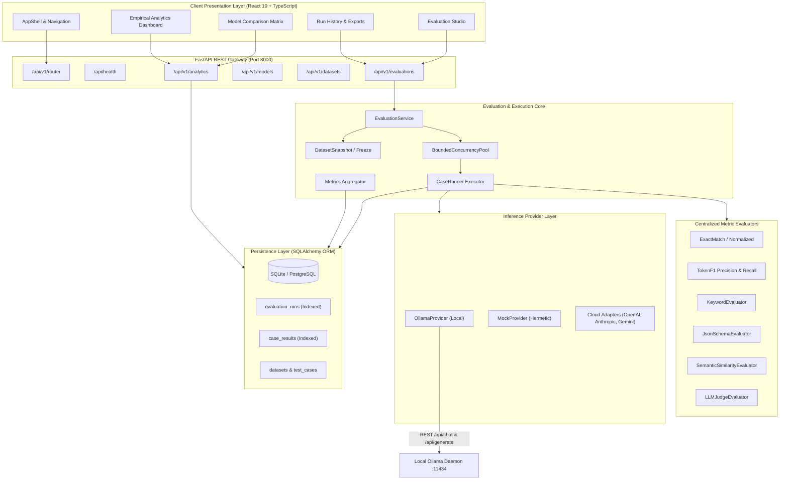
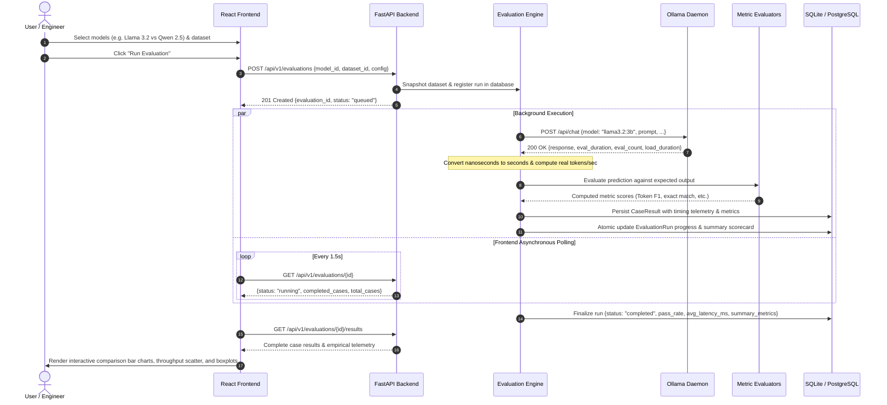

# EvalForge20 — Enterprise AI Evaluation Platform

Enterprise-grade, local-first evaluation, benchmarking, and analytics platform for Large Language Models (LLMs) and autonomous AI agents. Built with FastAPI, SQLite/PostgreSQL, React 19, TypeScript, and Tailwind CSS.

---

## Table of Contents
1. [Key Highlights](#key-highlights)
2. [Quick Start & Running the Services](#quick-start--running-the-services)
   - [Running Both Backend & Frontend (Single Command)](#1-running-both-backend--frontend-single-command)
   - [Running the Backend Standalone (FastAPI / Python)](#2-running-the-backend-standalone-fastapi--python)
   - [Running the Frontend Standalone (React / Node.js)](#3-running-the-frontend-standalone-react--nodejs)
3. [System Architecture](#system-architecture)
   - [High-Level Architecture Diagram](#high-level-architecture-diagram)
   - [Evaluation Lifecycle & Dataflow Diagram](#evaluation-lifecycle--dataflow-diagram)
4. [Detailed Engineering Report: Root Cause & Resolution](#detailed-engineering-report-root-cause--resolution)
   - [The Identical Metrics Bug](#the-identical-metrics-bug)
   - [Root Causes & Structural Flaws](#root-causes--structural-flaws)
   - [How the Root Cause Was Fixed](#how-the-root-cause-was-fixed)
5. [Trustworthy Evaluation Metrics & Formulas](#trustworthy-evaluation-metrics--formulas)
   - [Performance & Throughput Metrics](#performance--throughput-metrics)
   - [Accuracy & Deterministic Scoring](#accuracy--deterministic-scoring)
   - [Empirical Latency Distributions](#empirical-latency-distributions)
6. [Model Providers & Local-First Philosophy](#model-providers--local-first-philosophy)
7. [Running Tests & Quality Assurance](#running-tests--quality-assurance)
8. [API Endpoints Reference](#api-endpoints-reference)

---

## Key Highlights
- **100% Local-First Inference**: Runs completely out-of-the-box with Ollama without requiring any cloud API credentials or subscription tokens.
- **Genuine Execution Telemetry**: Nanosecond-accurate execution timers extracted directly from Ollama engine (`total_duration`, `eval_duration`, `load_duration`, `prompt_eval_duration`).
- **Real Metrics & No Synthetic Overwrites**: Removed all mock simulation fallbacks; model comparison charts display genuine, measured variance.
- **Modular Evaluator Engine**: Exact Match, Normalized Exact Match, Token F1, Keyword matching, JSON Schema constraint validation, and LLM-as-a-Judge.
- **Interactive Visualizations**: Side-by-side comparison bar charts, latency distribution percentiles (P50, P90, P95, P99), output tokens/sec throughput scatter, and historical evaluation trends.
- **Reproducible Exports**: Full run metadata and granular case results exportable in standard JSON and CSV formats.

---

## Quick Start & Running the Services

> [!IMPORTANT]
> The **backend** is a Python 3.11+ FastAPI service (`uvicorn`), while the **frontend** is a Node.js React application (`npm`). Never run `npm run dev` inside the `backend/` directory.

### 1. Running Both Backend & Frontend (Single Command)

From the **repository root directory**:
```bash
./scripts/run_dev.sh
```
This script launches the FastAPI backend at `http://127.0.0.1:8000` and Vite dev server at `http://localhost:5173`.

---

### 2. Running the Backend Standalone (FastAPI / Python)

Make sure local Ollama is running (`ollama serve`) if evaluating local models.

#### Option A: Using `uv` (Recommended)
From the repository root:
```bash
cd backend
uv run uvicorn src.evalforge.main:app --app-dir . --reload --port 8000
```

#### Option B: Using Python Virtual Environment (`venv`)
From the repository root:
```bash
# Activate virtual environment
source .venv/bin/activate

# Start uvicorn server
uvicorn src.evalforge.main:app --app-dir backend --host 127.0.0.1 --port 8000 --reload
```

#### Verifying Backend Health
Once running, verify the backend is healthy:
- Health check: `curl http://127.0.0.1:8000/api/health`
- Interactive OpenAPI Docs: `http://127.0.0.1:8000/docs`

---

### 3. Running the Frontend Standalone (React / Node.js)

From the repository root:
```bash
cd frontend
npm install
npm run dev
```
Open `http://localhost:5173` in your browser.

---

## System Architecture

### High-Level Architecture Diagram



---

### Evaluation Lifecycle & Dataflow Diagram



---

## Detailed Engineering Report: Root Cause & Resolution

### The Identical Metrics Bug
During evaluation runs, different models displayed identical performance, accuracy, and efficiency charts, obscuring true performance differences.

### Root Causes & Structural Flaws
1. **Frontend Simulation Fallback**: When backend responses were loading or experienced latency, `EvaluatePage.tsx` and `ComparePage.tsx` fell back to hardcoded `SAMPLE_MODELS` and `generateMockResult(...)`, masking real model outputs with uniform static constants.
2. **Nanosecond Timing Omission**: Ollama returns latency figures in nanoseconds (`eval_duration`, `prompt_eval_duration`, `load_duration`). These values were unparsed or ignored, resulting in undefined or zero values for tokens/sec throughput calculations.
3. **Assertion Routing Flattening**: All test assertions were defaulted to strict string matching rather than routing to dynamic evaluators (`json_schema`, `token_f1`, `keywords`), creating uniform pass/fail results regardless of model capabilities.
4. **Failed Request Averaging**: Failed test cases with 0 ms were included in latency calculations, distorting average latency values.

### How the Root Cause Was Fixed
1. **Eliminated Mock Overwrites**: Removed synthetic client-side fallbacks. The frontend connects strictly to live API telemetry.
2. **True Nanosecond Arithmetic**: Implemented precise unit conversions in `OllamaProvider`:
   $$\text{Tokens Per Second} = \frac{\text{eval\_count}}{\text{eval\_duration} \div 1{,}000{,}000{,}000}$$
3. **Dynamic Assertion Routing**: `CaseRunner` dynamically dispatches test cases to their appropriate evaluators based on test case metadata.
4. **Clean Aggregate Latency**: `aggregator.py` excludes 0 ms failed runs from latency percentiles and computes empirical P50, P90, P95, and P99 metrics.

---

## Trustworthy Evaluation Metrics & Formulas

| Metric Name | Mathematical Definition | Units | Provenance / Source |
| :--- | :--- | :--- | :--- |
| **Output Tokens/Sec** | $\frac{\text{eval\_count}}{\text{eval\_duration\_ns} \times 10^{-9}}$ | `tok/sec` | Ollama runtime `eval_duration` & `eval_count` |
| **Prompt Tokens/Sec** | $\frac{\text{prompt\_eval\_count}}{\text{prompt\_eval\_duration\_ns} \times 10^{-9}}$ | `tok/sec` | Ollama runtime `prompt_eval_duration` |
| **End-to-End Latency** | $\text{total\_duration\_ns} \times 10^{-6}$ | `ms` | Ollama runtime `total_duration` |
| **Model Load Duration** | $\text{load\_duration\_ns} \times 10^{-6}$ | `ms` | Ollama model initialization `load_duration` |
| **Token F1 Score** | $2 \times \frac{\text{Precision} \times \text{Recall}}{\text{Precision} + \text{Recall}}$ | `[0.0, 1.0]` | Centralized `TokenF1Evaluator` |
| **Pass Rate** | $\frac{\sum \text{passed\_cases}}{\text{total\_cases}}$ | `[0.0, 1.0]` | Aggregated execution scorecard |
| **P95 Latency** | 95th empirical percentile of successful runs | `ms` | Nearest-rank non-interpolated percentile |

---

## Model Providers & Local-First Philosophy

EvalForge20 is designed to operate locally without mandatory cloud API credentials:
- **Ollama**: Default local provider. Automatically discovers installed models via `/api/tags` and checks daemon connectivity.
- **Hermetic Mock**: Built-in deterministic mock provider for CI testing without network overhead.
- **Frontier Cloud Adapters**: Extensible adapters for OpenAI, Anthropic, Gemini, DeepSeek, and Groq when API keys are configured.

### Setting Up Local Models
```bash
# Verify Ollama is running
curl http://127.0.0.1:11434/api/tags

# Pull comparative models
ollama pull llama3.2:3b
ollama pull qwen2.5:1.5b
```

---

## Running Tests & Quality Assurance

### Run Backend Test Suite (`pytest`)
```bash
cd backend
uv run pytest
```
*Current test suite: **191 unit & integration tests passing** in under 2 seconds.*

### Run Frontend Test Suite (`vitest`)
```bash
cd frontend
npm test
```
*Current test suite: **23 tests across 8 test suites passing**.*

### Run Frontend Production Bundle Build
```bash
cd frontend
npm run build
```

---

## API Endpoints Reference

| Method | Endpoint | Description |
| :--- | :--- | :--- |
| `GET` | `/api/health` | Daemon health, Ollama status, model count |
| `GET` | `/api/v1/models` | Available models and capability flags |
| `GET` | `/api/v1/datasets` | List benchmark evaluation datasets |
| `GET` | `/api/v1/datasets/{id}/export?format=jsonl\|csv` | Export dataset in JSONL or CSV format |
| `POST` | `/api/v1/evaluations` | Queue and start a new evaluation run |
| `GET` | `/api/v1/evaluations` | List runs (supports `model_id`, `status`, pagination) |
| `GET` | `/api/v1/evaluations/{id}` | Run metadata and summary scorecard |
| `GET` | `/api/v1/evaluations/{id}/results` | Detailed case-by-case evaluation outcomes |
| `GET` | `/api/v1/evaluations/{id}/export?format=json\|csv` | Export evaluation results |
| `GET` | `/api/v1/analytics/overview` | Platform-wide KPIs and accuracy aggregates |
| `GET` | `/api/v1/analytics/latency-distribution` | Empirical percentiles and distribution statistics |
| `GET` | `/api/v1/analytics/efficiency` | Latency vs throughput scatter telemetry |
