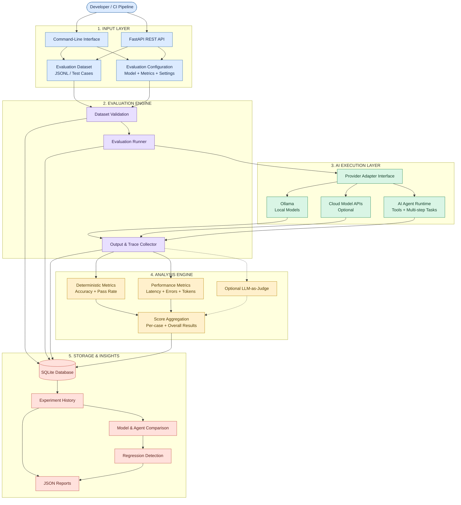
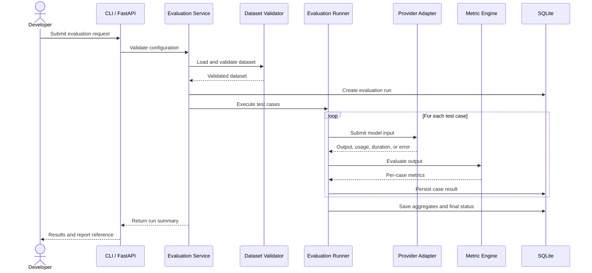

# EvalForge20

<p align="center">
  <strong>Evidence-Driven Evaluation for LLMs and AI Agents</strong>
</p>

<p align="center">
  An open-source, local-first platform to benchmark, evaluate, and compare AI models and agents through reproducible experiments and measurable results.
</p>

<p align="center">
  <a href="#features">Features</a> •
  <a href="#architecture">Architecture</a> •
  <a href="#technology-stack">Tech Stack</a> •
  <a href="#quick-start">Quick Start</a> •
  <a href="#roadmap">Roadmap</a> •
  <a href="#contributing">Contributing</a>
</p>

---

## Overview

**EvalForge20** is an open-source AI evaluation platform designed to help developers systematically evaluate, benchmark, and compare Large Language Models (LLMs) and AI agents.

As new models and AI agents emerge, choosing the right system for a specific workload becomes increasingly difficult. Model rankings alone cannot tell developers how well a model performs on their own datasets, how reliable an agent is when using tools, or whether a new model version introduces regressions.

EvalForge20 addresses this problem through a unified evaluation engine that measures model and agent performance using configurable datasets, deterministic metrics, execution traces, and reproducible experiments.

The platform follows a **local-first approach**, supporting local inference through Ollama while providing an extensible architecture for additional local and cloud providers.

### Mission

Help developers make better AI decisions through transparent measurements, reproducible experiments, and evidence—not hype.

## The Problem

AI developers face several challenges:

- Model benchmarks often fail to represent real-world application requirements.
- Comparing different models across custom tasks requires repetitive manual testing.
- AI agent failures can be difficult to reproduce and diagnose.
- Latency, reliability, accuracy, and resource usage are often evaluated separately.
- Model or prompt updates can introduce regressions without being detected.
- Hosted evaluation services may introduce cost, privacy, or infrastructure constraints.

## The Solution

EvalForge20 provides a unified framework for evaluating AI systems against defined tasks and measurable criteria.

It aims to help developers:

- Run evaluations against custom datasets.
- Compare models using consistent evaluation configurations.
- Measure accuracy, latency, reliability, and available token usage.
- Inspect individual test-case results and agent execution traces.
- Detect regressions between evaluation runs.
- Export structured reports for development workflows and CI pipelines.
- Evaluate local models without requiring paid API access.

## Features

### 1. Dataset Management

- JSONL dataset import and validation.
- Schema validation and useful error messages.
- Stable test-case identifiers.
- Dataset versioning and content hashes.
- Custom metadata and task categories.
- Reusable datasets across evaluation runs.

### 2. LLM Evaluation

- Evaluate models against custom test cases.
- Support local models through Ollama.
- Extensible provider-adapter architecture.
- Capture model outputs, execution duration, and errors.
- Record token usage when provided by the model provider.
- Support task-specific evaluation criteria.

### 3. Evaluation Metrics

EvalForge20 provides a comprehensive suite of deterministic, reference-based, and local model-based metrics:

| Metric ID | Metric Name | Category | Purpose |
|---|---|---|---|
| `exact_match` | Exact Match | Deterministic | Strict string/structure equivalence check |
| `normalized_match` | Normalized Match | Deterministic | Whitespace, case, and punctuation normalized equivalence |
| `token_f1` | Token-Level F1 Score | Deterministic | Token precision, recall, and harmonic F1 score |
| `classification_accuracy` | Classification Accuracy | Deterministic | Exact class label match |
| `json_validity` | JSON Validity | Deterministic | Validates whether response parses as valid JSON |
| `json_schema` | JSON Schema Validity | Deterministic | Validates payload against JSON Schema definition |
| `response_completeness` | Response Completeness | Deterministic | Word count bounds and sentence termination checks |
| `latency` / `pass_rate` | Performance Metrics | Deterministic | Latency, pass rate, and provider error distribution |
| `ollama_judge_answer_relevance` | Answer Relevance | Model-Based | Evaluates prompt responsiveness via local Ollama judge |
| `ollama_judge_factual_correctness` | Factual Correctness | Model-Based | Evaluates factual correctness against reference ground truth |
| `ollama_judge_context_faithfulness` | Context Faithfulness | Model-Based | Evaluates groundedness and checks hallucinations |
| `ollama_judge_explanation_quality` | Explanation Quality | Model-Based | Evaluates logical coherence and step-by-step clarity |


### 4. AI Agent Evaluation

EvalForge20 is designed to evaluate more than individual model responses.

Agent evaluation can measure:

- Task completion and success rate.
- Tool selection and argument validity.
- Tool execution failures.
- Number of steps and retries.
- Timeouts and execution duration.
- Intermediate actions and execution traces.
- Failure patterns across repeated tasks.

Agent integrations will use explicit adapters and controlled tool interfaces rather than executing arbitrary model-generated code.

### 5. Experiment Tracking

- Persistent evaluation-run history.
- Per-case outputs and metric results.
- Model, dataset, and configuration metadata.
- Run status and error tracking.
- Partial-result preservation when cases fail.
- Structured JSON report generation.

### 6. Model and Agent Comparison

Compare evaluation runs using compatible datasets, configurations, and metric definitions.

The comparison engine is intended to:

- Highlight improvements and regressions.
- Compare accuracy, latency, and reliability.
- Apply configurable regression thresholds.
- Identify individual cases responsible for score changes.
- Provide evidence behind each comparison.

EvalForge20 does not assume that one model is universally best. Results depend on the task, dataset, configuration, and evaluation method.

### 7. Developer-Friendly Interfaces

- Python evaluation engine.
- FastAPI-based HTTP interface.
- Command-line interface for evaluation workflows.
- Machine-readable evaluation reports.
- CI-friendly testing and regression checks.
- A future web dashboard built on top of the backend.

> **Implementation note:** Features listed above describe the intended project capabilities. Mark features as available only after their implementation and tests are complete.


## Architecture

EvalForge20 transforms an evaluation dataset into measurable evidence about AI model and agent performance. Developers submit evaluation tasks through the CLI or API, the evaluation engine executes them against selected AI systems, and the results are stored, compared, and exported as reports.



### How It Works

1. **Input:** A developer supplies a dataset and evaluation configuration through the CLI or REST API.
2. **Validation:** EvalForge20 checks the dataset and configuration before starting the run.
3. **Execution:** The evaluation runner sends test cases to a selected local model, cloud provider, or AI agent adapter.
4. **Analysis:** The system calculates applicable accuracy, reliability, and performance metrics. An LLM judge is optional.
5. **Storage:** Run metadata, case results, and available traces are persisted for later inspection.
6. **Comparison:** Developers compare runs, identify regressions, and export reports to support model-selection decisions.

**The outcome:** Evidence showing how each evaluated AI system performs on the developer's own tasks—not merely a generic leaderboard ranking.


### Evaluation Lifecycle



### Architecture Components

| Component | Responsibility |
|---|---|
| CLI | Run evaluations and inspect results from the terminal |
| FastAPI | Expose evaluation workflows over HTTP |
| Application Service | Coordinate application use cases |
| Dataset Registry | Validate and version datasets |
| Evaluation Runner | Execute test cases with bounded concurrency |
| Provider Adapters | Normalize interactions with model providers |
| Agent Adapters | Capture task outcomes, tool calls, and traces |
| Metric Engine | Calculate per-case and aggregate metrics |
| Judge Adapter | Optional model-based evaluation with explicit rubrics |
| Storage Layer | Persist datasets, runs, results, and metadata |
| Comparison Engine | Compare compatible runs and detect regressions |
| Report Exporter | Generate structured evaluation reports |

## Technology Stack

The proposed initial implementation uses the following technologies.

| Technology | Purpose |
|---|---|
| Python 3.11+ | Core evaluation engine |
| FastAPI | REST API |
| Pydantic | Data validation and schemas |
| SQLAlchemy | Database access |
| SQLite | Initial persistent storage |
| Alembic | Database migrations |
| httpx | HTTP client and asynchronous requests |
| Ollama | Local model inference |
| Typer | Command-line interface |
| pytest | Automated testing |
| Ruff | Linting and formatting |
| GitHub Actions | Continuous integration |

The initial architecture intentionally avoids unnecessary infrastructure. Additional services should be introduced only when actual performance or deployment requirements justify them.

## Quick Start

The following instructions describe the intended development workflow. Adjust commands to match the implemented repository.

### Prerequisites

- Python 3.11 or newer.
- Git.
- Ollama for local model inference.
- A model installed in Ollama for real-provider evaluations.

### 1. Clone the Repository

Replace `<your-username>` with the GitHub account that owns the repository.

```bash
git clone https://github.com/<your-username>/EvalForge20.git
cd EvalForge20
```

### 2. Create a Virtual Environment

```bash
python -m venv .venv
```

Activate it on Linux or macOS:

```bash
source .venv/bin/activate
```

Activate it on Windows PowerShell:

```powershell
.venv\Scripts\Activate.ps1
```

### 3. Install Dependencies

If the project uses an installable `pyproject.toml`:

```bash
python -m pip install --upgrade pip
pip install -e ".[dev]"
```

Otherwise, install dependencies using the dependency file maintained by the repository.

### 4. Configure Ollama

Install Ollama from:

https://ollama.com/

Pull an example model:

```bash
ollama pull qwen2.5:3b
```

Verify that the model is available:

```bash
ollama list
```

Choose a model suitable for your hardware. Performance and memory requirements depend on the model and its configuration.

### 5. Configure Environment Variables

If environment-based configuration is implemented, create a local `.env` file using the supported settings.

Example proposed configuration:

```dotenv
EVALFORGE20_ENV=development
EVALFORGE20_DATABASE_URL=sqlite:///./data/evalforge20.db
EVALFORGE20_OLLAMA_BASE_URL=http://localhost:11434
EVALFORGE20_LOG_LEVEL=INFO
EVALFORGE20_LOG_PROMPTS=false
```

These environment variable names must be implemented in the application before they can be used. Never commit secrets or private evaluation data.

### 6. Run an Evaluation

EvalForge20 provides verified CLI workflows via `evalforge20` or `python -m evalforge`:

Discover local models and check readiness:
```bash
python -m evalforge models
python -m evalforge models check qwen2.5:3b
```

Validate a dataset (JSON, JSONL, or CSV):
```bash
python -m evalforge datasets validate examples/datasets/qa_sample.json
```

Run an evaluation using local Ollama model:
```bash
python -m evalforge evaluate \
  --dataset examples/datasets/qa_sample.json \
  --provider ollama \
  --model qwen2.5:3b \
  --metrics exact_match,token_f1,response_completeness
```

List historical evaluation runs:
```bash
python -m evalforge runs list
```

Compare candidate and baseline runs:
```bash
python -m evalforge compare <BASELINE_RUN_ID> <CANDIDATE_RUN_ID>
```

Export human-readable Markdown or tabular CSV reports:
```bash
python -m evalforge report export <RUN_ID> --format markdown --output reports/run.md
python -m evalforge report export <RUN_ID> --format csv --output reports/cases.csv
python -m evalforge report export <RUN_ID> --format json --output reports/run.json
```

### 7. Start the API

For an application exposed as `app.main:app`, use:

```bash
uvicorn app.main:app --reload
```

When the API is implemented, its documentation may be available at:

- Swagger UI: `http://127.0.0.1:8000/docs`
- OpenAPI schema: `http://127.0.0.1:8000/openapi.json`

Update the module path if the repository uses a different application entry point.

## Dataset Format

JSONL is a convenient format for evaluation datasets. Each non-empty line represents one test case.

Example:

```jsonl
{"id":"capital-001","input":"What is the capital of France?","expected_output":"Paris","metadata":{"category":"geography"}}
{"id":"math-001","input":"What is 6 multiplied by 7?","expected_output":"42","metadata":{"category":"math"}}
{"id":"summary-001","input":"Summarize: The team shipped the release on Friday.","expected_output":"The release shipped on Friday.","metadata":{"category":"summarization"}}
```

### Dataset Validation Requirements

A robust dataset validator should:

1. Parse each line independently.
2. Report malformed JSON with its line number.
3. Validate required fields and field types.
4. Detect duplicate case identifiers.
5. Preserve useful metadata.
6. Avoid silently dropping invalid cases.
7. Track dataset versions and content hashes where supported.

Different task types may require additional fields, such as JSON schemas, assertions, or agent task instructions.

## Metrics and Scoring

EvalForge20 should keep raw measurements, per-case results, and aggregate metrics separate.

| Metric | Description | Consideration |
|---|---|---|
| Exact Match | Exact output equality | Best for tasks with deterministic expected outputs |
| Normalized Match | Equality after documented normalization | Normalization rules affect scores |
| JSON Validity | Whether output parses as JSON | Valid syntax does not guarantee correctness |
| Schema Validity | Whether output satisfies a schema | Schema compliance does not guarantee factual accuracy |
| Pass Rate | Passed eligible cases divided by eligible cases | Always report the denominator |
| Latency | Time required to produce a response | Document units and aggregation method |
| Error Rate | Provider or execution failures | Separate execution errors from incorrect answers |
| Token Usage | Tokens reported by the provider | Availability and definitions vary |
| Estimated Cost | Estimated provider charges | Requires an explicit pricing source and assumptions |

### LLM-as-Judge

Model-based judging may be added for tasks where deterministic evaluation is insufficient.

Judge results should identify:

- Judge model and provider.
- Rubric and prompt version.
- Scoring scale and aggregation method.
- Known limitations and uncertainty.

Judge-generated scores must be clearly distinguished from deterministic measurements.

## API Overview

The following endpoints are proposed for the initial API. Document them as available only after implementation and testing.

| Method | Endpoint | Purpose |
|---|---|---|
| `GET` | `/health` | Check process health |
| `GET` | `/ready` | Check readiness and dependencies |
| `GET` | `/v1/providers` | List configured provider adapters |
| `POST` | `/v1/datasets/validate` | Validate a dataset |
| `POST` | `/v1/datasets` | Register a dataset version |
| `GET` | `/v1/datasets` | List datasets |
| `POST` | `/v1/evaluations` | Create an evaluation run |
| `GET` | `/v1/evaluations/{run_id}` | Retrieve run status and aggregate metrics |
| `GET` | `/v1/evaluations/{run_id}/results` | Retrieve per-case results |
| `GET` | `/v1/runs` | List evaluation runs |
| `POST` | `/v1/compare` | Compare compatible evaluation runs |
| `GET` | `/v1/reports/{run_id}` | Retrieve or export a report |

Long-running evaluations should have explicit run states, bounded execution, and a mechanism for retrieving partial results. API errors should be structured and should not expose secrets.

## Storage Design

The initial storage model may include the following entities:

- `datasets`
- `dataset_versions`
- `evaluation_cases`
- `model_configurations`
- `agent_configurations`
- `evaluation_configurations`
- `evaluation_runs`
- `case_results`
- `metric_results`
- `execution_traces`
- `provider_usage`
- `run_comparisons`

Use normalized tables for important entities, appropriate indexes, transactions, and database migrations. Apply retention limits to large outputs and execution traces.

## Reliability and Error Handling

EvalForge20 should:

- Apply timeouts to model and tool calls.
- Bound concurrency and memory usage.
- Retry only errors that are safe to retry.
- Record retry attempts.
- Preserve completed results if later cases fail.
- Distinguish provider errors, task failures, timeouts, and invalid outputs.
- Support explicit cancellation where implemented.
- Avoid silently switching between local and hosted providers.
- Never fabricate missing token usage, costs, or metrics.

Possible run states include `pending`, `running`, `completed`, `completed_with_errors`, `failed`, and `cancelled`.

## Security and Privacy

Local-first execution does not remove the need for security controls.

- Keep credentials outside source control.
- Redact secrets from logs and error messages.
- Avoid logging prompts and model outputs by default.
- Validate uploaded datasets and file paths.
- Set limits for dataset size, input/output length, and execution time.
- Never execute arbitrary code generated by a model.
- Restrict agent tools to explicit allowlists.
- Bind the development API to localhost by default.
- Add authentication and transport security before exposing the service to untrusted networks.
- Define retention and deletion policies for datasets, outputs, and traces.
- Never send local evaluation data to external providers without explicit configuration.

## Testing and Quality Assurance

### Unit Tests

- Dataset parsing and validation.
- Metric calculations and edge cases.
- Aggregate calculations and missing values.
- Provider response normalization.
- Error classification and retry policies.
- Run-comparison compatibility rules.

### Integration Tests

- End-to-end evaluation using a deterministic mock provider.
- Database persistence and retrieval after restart.
- API validation and error handling.
- CLI execution and report export.
- Partial failures and cancellation behavior.

### Optional Ollama Tests

- Verify local Ollama connectivity.
- Check model availability.
- Run a small smoke evaluation.

The default CI test suite should use deterministic mocks and must not require paid APIs or a running Ollama instance.

Suggested quality checks, depending on the repository configuration:

```bash
pytest
ruff check .
ruff format --check .
```

A skipped test is not a passing test. Report test results and limitations accurately.

## Development Roadmap

### Phase 1 — Core Evaluation Engine

- Define domain models and dataset schemas.
- Implement JSONL validation.
- Implement deterministic metrics.
- Build a mock provider and evaluation runner.
- Persist runs and per-case results in SQLite.
- Add unit and end-to-end tests.

### Phase 2 — Local Model Support

- Implement the Ollama adapter.
- Normalize provider outputs and usage information.
- Add timeouts and bounded concurrency.
- Preserve partial results.
- Export reproducible JSON reports.

### Phase 3 — Developer Workflows

- Implement the CLI.
- Expose core operations through FastAPI.
- Add run history and per-case result inspection.
- Implement comparisons and regression thresholds.
- Document configuration and dataset formats.

### Phase 4 — AI Agent Evaluation

- Define a controlled agent adapter interface.
- Capture task completion, tool calls, and execution traces.
- Measure tool failures, retries, and step counts.
- Add deterministic mock-agent tests.

### Phase 5 — Advanced Evaluation

- Introduce optional LLM-as-judge metrics.
- Add CI-friendly regression checks and exit codes.
- Expand provider integrations based on community demand.
- Consider a web dashboard after backend contracts stabilize.

## Suggested Repository Structure

```text
EvalForge20/
├── app/
│   ├── api/
│   │   ├── routes/
│   │   └── schemas/
│   ├── application/
│   ├── domain/
│   ├── providers/
│   │   ├── base.py
│   │   └── ollama.py
│   ├── agents/
│   ├── datasets/
│   ├── metrics/
│   ├── runner/
│   ├── storage/
│   ├── reporting/
│   ├── cli/
│   ├── config.py
│   └── main.py
├── migrations/
├── examples/
│   └── datasets/
├── tests/
│   ├── unit/
│   ├── integration/
│   └── fixtures/
├── docs/
│   ├── ARCHITECTURE.md
│   ├── API.md
│   ├── METRICS.md
│   ├── DATASET_FORMAT.md
│   └── SECURITY.md
├── .github/
│   └── workflows/
├── .env.example
├── .gitignore
├── pyproject.toml
├── README.md
└── LICENSE
```

Adapt this structure to the existing repository rather than duplicating packages or configuration files.

## Contributing

Contributions are welcome, including:

- New deterministic metrics and evaluation methods.
- Dataset formats and validation improvements.
- Local and hosted provider adapters.
- AI agent integrations.
- Reproducibility and reporting improvements.
- Tests, documentation, examples, and bug fixes.

### Contribution Guidelines

1. Discuss substantial changes in an issue before implementation.
2. Keep provider-specific logic behind the adapter interface.
3. Add tests for new features and edge cases.
4. Document metric definitions and assumptions.
5. Keep pull requests focused.
6. Run the available checks before submitting a pull request.
7. Never commit credentials, secrets, or private datasets.

## License

Choose and add a license before publishing the project.

- **MIT License:** A simple permissive license suitable for broad adoption.
- **Apache License 2.0:** A permissive license that also includes an explicit patent license.

Add the appropriate `LICENSE` file and update this section to reflect the license actually selected.

## Documentation Index

Detailed guides are available in the `docs/` directory:

- [Architecture & Design](docs/ARCHITECTURE.md)
- [Dataset Format Specification](docs/DATASET_FORMAT.md)
- [Metrics Reference](docs/METRICS.md)
- [Evaluators Guide](docs/EVALUATORS.md)
- [RAG Evaluation](docs/RAG_EVALUATION.md)
- [AI Agent Evaluation](docs/AGENT_EVALUATION.md)
- [LangSmith Integration](docs/LANGSMITH.md)
- [REST API Reference](docs/API.md)
- [Configuration Reference](docs/CONFIGURATION.md)
- [Testing & Quality Assurance](docs/TESTING.md)
- [Contributing Guide](CONTRIBUTING.md)
- [Security Policy](SECURITY.md)
- [Changelog](CHANGELOG.md)

## Project Status and Disclaimer

EvalForge20 aims to make AI evaluation more transparent, reproducible, and accessible. Results depend on dataset quality, metric definitions, model configurations, and execution conditions.

Benchmark scores do not guarantee real-world performance, safety, or factual correctness. Comparisons should be interpreted within the context of the workload and evaluation methodology.

**EvalForge20 is built around one principle: better AI decisions require transparent measurements and reproducible evidence.**

