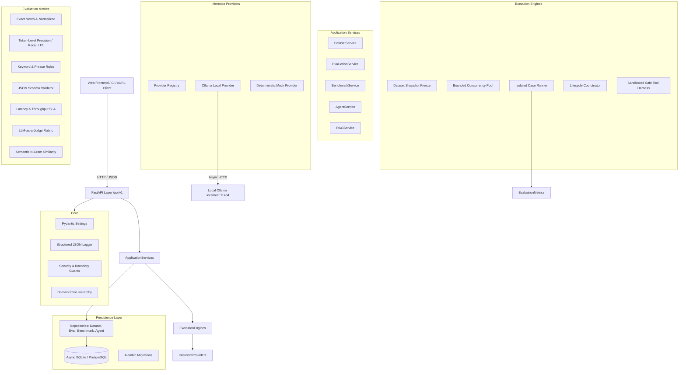

<div align="center">


**Production-Minded, Local-First Open-Source Evaluation Platform for LLMs and AI Agents**

<br/>

[](https://python.org)
[](https://fastapi.tiangolo.com)
[](https://www.sqlalchemy.org/)
[](https://ollama.com)
[](tests/)
[](https://astral.sh/ruff)

<br/>

[Explore the Repository](https://github.com/reddy895/EvalForge20) · [Report an Issue](https://github.com/reddy895/EvalForge20/issues) · [API Documentation](http://127.0.0.1:8000/docs)

</div>

<br/>

---

## 01 — Product Vision

**EvalForge20** is an open-source, local-first platform for evaluating, benchmarking, and comparing:

- **Large Language Models (LLMs)** hosted locally via Ollama.
- **AI Agents that invoke tools** within a sandboxed, permissioned execution harness.
- **Multi-Model Benchmarks** evaluated against identical, cryptographic dataset snapshots.
- **RAG Pipelines** measuring factual retrieval, ground-truth faithfulness, and context relevance.

### Core Principles
1. **Local-First & Zero Required API Keys**: Runs hermetically against your local Ollama daemon or built-in deterministic mock provider.
2. **Reproducible Evidence**: Metric outputs record raw inputs, actual outputs, timings, calculation methods, and SHA-256 snapshot hashes without invented measurements.
3. **Decoupled Backend**: The FastAPI backend is independently accessible via clean REST endpoints with stable schemas, designed for integration with any web frontend or CI/CD workflow.

---

## 02 — Architecture



---

## 03 — Requirements & Quickstart

### Prerequisites
- **Python**: 3.11+
- **Ollama** (optional for local inference): [ollama.com](https://ollama.com)
- **Node.js 18+** (optional for running the React frontend)

### One-Command Startup
To set up dependencies, initialize the database, seed default benchmarks, and start the development server:

```bash
./scripts/run_dev.sh
```

### Manual Backend Setup

```bash
# 1. Clone repository
git clone https://github.com/reddy895/EvalForge20.git
cd EvalForge20

# 2. Create virtual environment & install dependencies
python3 -m venv .venv
source .venv/bin/activate
pip install -e ".[dev]"

# 3. Configure environment
cp .env.example .env

# 4. Seed standard evaluation benchmarks
python scripts/seed_datasets.py

# 5. Start development API server
uvicorn src.evalforge.main:app --host 127.0.0.1 --port 8000 --reload
```

Interactive documentation is available at:
- **Swagger UI**: `http://127.0.0.1:8000/docs`
- **ReDoc**: `http://127.0.0.1:8000/redoc`

---

## 04 — Ollama Local Inference Configuration

EvalForge20 connects directly to your local Ollama daemon at `http://localhost:11434`.

```bash
# Start Ollama service in background
ollama serve

# Pull desired evaluation models
ollama pull llama3.2
ollama pull qwen2.5:7b
ollama pull mistral:7b
```

### Testing Ollama Connection
Check Ollama daemon reachability through EvalForge20:

```bash
curl -s http://127.0.0.1:8000/api/v1/providers/ollama/health | jq
```

Response:
```json
{
  "status": "healthy",
  "base_url": "http://localhost:11434",
  "reachable": true,
  "version": "0.4.7",
  "suggestion": null
}
```

If Ollama is not installed or offline, EvalForge20 returns clear diagnostics without crashing and provides instructions on how to start the service. All test suites run hermetically without external dependencies using the built-in `mock` provider.

---

## 05 — Evaluation Metrics Catalog

Metric outputs contain explicit calculation metadata, parameters, and pass/fail thresholds:

| Metric Name | Type | Description | Measurement Logic |
| :--- | :--- | :--- | :--- |
| `exact_match` | Deterministic | Strict string equality | Case & whitespace sensitive comparison |
| `normalized_exact_match` | Deterministic | Normalized text equality | Case-insensitive, stripped punctuation and articles |
| `token_f1` | Deterministic | Token overlap | Precision, Recall, and harmonic F1 of token sequences |
| `keyword_match` | Deterministic | Keyword & phrase rules | Verifies presence of required terms and absence of prohibited phrases |
| `json_schema` | Deterministic | Structured JSON validation | Parses JSON from markdown fences/text and verifies fields & types |
| `latency_sla` | Deterministic | Performance check | Asserts latency is within target SLA and measures throughput (tokens/sec) |
| `llm_as_judge` | Model-Assisted | Rubric-based rating | Evaluates answer quality on a 1-5 rubric (flagged as automated estimate) |
| `semantic_similarity` | Lexical-Semantic | N-gram Jaccard overlap | Blends unigram and bigram Jaccard coefficients for local similarity |

---

## 06 — API Usage Examples (cURL)

### 1. Check System Health
```bash
curl -s http://127.0.0.1:8000/health | jq
```

### 2. Create an Evaluation Dataset
```bash
curl -s -X POST http://127.0.0.1:8000/api/v1/datasets \
  -H "Content-Type: application/json" \
  -d '{
    "name": "Math Reasoning Suite",
    "description": "Multi-step arithmetic word logic",
    "tags": ["math", "reasoning"],
    "cases": [
      {
        "prompt": "What is 15 multiplied by 8?",
        "expected_output": "120"
      }
    ]
  }' | jq
```

### 3. Import Dataset via JSONL
```bash
curl -s -X POST http://127.0.0.1:8000/api/v1/datasets/import \
  -F "name=Coding Benchmark" \
  -F "format=jsonl" \
  -F "file=@tests/sample_data.jsonl" | jq
```

### 4. Execute an Evaluation Run
```bash
curl -s -X POST http://127.0.0.1:8000/api/v1/evaluations \
  -H "Content-Type: application/json" \
  -d '{
    "name": "Qwen 2.5 Coding Eval",
    "model_id": "mock-qwen-2.5-7b",
    "provider": "mock",
    "dataset_id": "<DATASET_UUID>",
    "config": {
      "metrics": ["exact_match", "token_f1"],
      "concurrency": 4,
      "temperature": 0.0
    }
  }' | jq
```

### 5. Poll Evaluation Progress and Results
```bash
# Get summary & status
curl -s http://127.0.0.1:8000/api/v1/evaluations/<EVALUATION_UUID> | jq

# Get case-level results
curl -s http://127.0.0.1:8000/api/v1/evaluations/<EVALUATION_UUID>/results | jq
```

### 6. Run Multi-Model Benchmark Comparison
```bash
curl -s -X POST http://127.0.0.1:8000/api/v1/benchmarks/compare \
  -H "Content-Type: application/json" \
  -d '{
    "name": "Llama vs Qwen Algorithmic Benchmark",
    "dataset_id": "<DATASET_UUID>",
    "models": ["mock-llama-3.1-8b", "mock-qwen-2.5-7b"],
    "provider": "mock"
  }' | jq
```

### 7. Run AI Agent Evaluation with Sandboxed Tools
```bash
curl -s -X POST http://127.0.0.1:8000/api/v1/agent-evaluations \
  -H "Content-Type: application/json" \
  -d '{
    "model_id": "mock-llama-3.1-8b",
    "provider": "mock",
    "task": "Please use tool calculator to evaluate expression 45 * 12.",
    "tools": [
      {
        "name": "calculator",
        "description": "Performs mathematical arithmetic",
        "parameters": {
          "type": "object",
          "properties": {
            "expression": {"type": "string"}
          }
        }
      }
    ],
    "expected_tools": ["calculator"],
    "max_steps": 5
  }' | jq

# Retrieve agent step traces
curl -s http://127.0.0.1:8000/api/v1/agent-evaluations/<AGENT_EVAL_UUID>/traces | jq
```

---

## 07 — Frontend Integration Contract

The EvalForge20 backend is designed to integrate cleanly with any web client:

- **Base URL**: `http://127.0.0.1:8000`
- **API Prefix**: `/api/v1`
- **CORS Allowed Origins**: Configured via `CORS_ORIGINS` in `.env` (defaults to `http://localhost:5173,http://127.0.0.1:5173`).
- **Evaluation Lifecycle States**:
  - `queued`: Task created and registered.
  - `running`: Worker tasks actively dispatching test cases.
  - `completed`: All cases executed, scorecard aggregated.
  - `failed`: Fatal error or model initialization crash.
  - `cancelled`: Aborted by user request.
- **Polling Strategy**: The frontend should poll `GET /api/v1/evaluations/{id}` every 500ms–1000ms until `status` enters a terminal state (`completed`, `failed`, or `cancelled`), then fetch `GET /api/v1/evaluations/{id}/results`.
- **Standardized Error Format**:
  ```json
  {
    "error": {
      "code": "RESOURCE_NOT_FOUND",
      "message": "Dataset with identifier '...' was not found.",
      "details": null,
      "request_id": "b3e94a8e-..."
    }
  }
  ```

---

## 08 — Security & Safety

- **Local Host Binding**: Server binds to `127.0.0.1` by default to prevent accidental exposure to external networks.
- **Safe Agent Tool Sandboxing**: Agent tool calls are executed through an explicit allowlist. Arbitrary shell execution, arbitrary Python code execution, and filesystem operations are strictly forbidden.
- **Path Traversal Defense**: All file paths and dataset imports validate against directory traversal and null byte injections.
- **Payload Guardrails**: Request content-length and dataset test case limits are enforced by default.
- **Error Sanitization**: Unhandled exceptions are logged with request context but never leak sensitive system paths or stack traces to clients.
- **Production Warning**: Deploying to public networks requires an authenticated reverse proxy (e.g. Nginx with TLS and API key/OAuth verification).

---

## 09 — Testing & Quality Assurance

EvalForge20 includes an automated test suite across units, integrations, APIs, and security boundaries:

```bash
# Run complete test suite
pytest

# Run tests with verbose output
pytest -v

# Run with linting & code formatting checks via Ruff
ruff check .
ruff format --check .
```

All unit and integration tests run offline without requiring external network access or a running Ollama daemon by utilizing the `MockProvider`.

---

## 10 — Project Roadmap

- [x] Local-first asynchronous FastAPI backend architecture
- [x] Local Ollama provider with streaming, options, and tool support
- [x] Deterministic mock provider for hermetic testing
- [x] Dataset management with JSONL and CSV import/export
- [x] Deterministic metric suite (Exact Match, Token F1, Keywords, JSON Schema, SLA)
- [x] Model-assisted metrics (LLM-as-a-Judge, Semantic Similarity)
- [x] Multi-model benchmark comparisons with cryptographic snapshot hashes
- [x] Sandboxed AI agent evaluation with step trace auditing
- [x] RAG evaluation extension (Context Relevance, Faithfulness, Citations)
- [ ] Persistent Celery/Redis distributed queue for multi-node deployments
- [ ] Direct vLLM and HuggingFace Local Providers

---

## 11 — Contributing

Contributions to EvalForge20 are welcome!

1. Fork the repository and create your feature branch (`git checkout -b feature/amazing-metric`).
2. Implement your changes, including tests and type hints.
3. Run `ruff check .` and `pytest` to verify all tests pass cleanly.
4. Open a Pull Request with a clear summary of your changes.

---

## 12 — License Status

See the repository [`LICENSE`](LICENSE) file for applicable open-source terms.

<div align="center">
<br/>
<sub>EvalForge20 · Built for local-first, evidence-grounded AI evaluation</sub>
</div>
