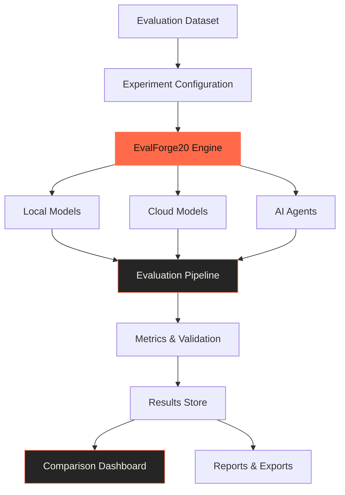

 <div align="center">


<br/>

[](https://github.com/reddy895/EvalForge20/stargazers)
[](https://github.com/reddy895/EvalForge20/forks)
[](LICENSE)
[](https://github.com/reddy895/EvalForge20/issues)

<br/>

**One platform. Multiple models. Reproducible evaluations.**

[Explore the Repository](https://github.com/reddy895/EvalForge20) · [Report a Bug](https://github.com/reddy895/EvalForge20/issues) · [Request a Feature](https://github.com/reddy895/EvalForge20/issues)

</div>

---

## `01` — The idea

AI models are released every day. AI agents are becoming increasingly capable. But comparing them fairly is still harder than it should be.

Which model follows instructions better? Which one produces more accurate answers? Which agent completes a task reliably? How much latency and computational cost does each evaluation require?

**EvalForge20 is an open-source platform designed to make those comparisons measurable, reproducible, and accessible.**

Instead of relying on marketing claims or isolated examples, developers can build evaluation datasets, execute experiments, compare results, and understand how models and agents perform under consistent conditions.

## `02` — What makes it different?

<table>
<tr>
<td width="50%">

### 🧠 Model evaluation

Evaluate LLM outputs for correctness, relevance, instruction following, consistency, and other task-specific criteria.

</td>
<td width="50%">

### 🤖 Agent evaluation

Test AI agents on task completion, tool usage, execution success, and multi-step workflows.

</td>
</tr>
<tr>
<td width="50%">

### 🖥️ Local-first execution

Support local model workflows through Ollama, reducing dependence on paid APIs and external evaluation platforms.

</td>
<td width="50%">

### 📊 Evidence-driven comparison

Organize experiment results into comparable metrics, execution traces, latency measurements, and reports.

</td>
</tr>
<tr>
<td width="50%">

### 🔬 Reproducible experiments

Reuse datasets, evaluation configurations, and test cases to compare models under consistent conditions.

</td>
<td width="50%">

### 🧩 Extensible architecture

Build a modular evaluation engine that can support new model providers, metrics, datasets, and agent frameworks.

</td>
</tr>
</table>

## `03` — How it works



The intended workflow is straightforward:

1. Create or import an evaluation dataset.
2. Select a model, agent, or group of candidates.
3. Configure metrics and evaluation parameters.
4. Execute the experiment.
5. Inspect outputs, failures, latency, and scores.
6. Compare results and export findings.

## `04` — Evaluation dimensions

| Dimension | What it measures |
|---|---|
| Accuracy | Whether outputs match expected answers or ground truth |
| Instruction following | Whether a model follows the requested constraints |
| Relevance | How well the response addresses the task |
| Consistency | Whether similar inputs produce dependable results |
| Latency | How long an execution takes |
| Token usage | How many tokens are consumed, where measurable |
| Cost | Estimated inference cost when provider pricing and usage data are available |
| Tool execution | Whether an agent selects and uses tools correctly |
| Task completion | Whether an agent achieves the required outcome |
| Reliability | Failures, timeouts, invalid outputs, and execution success rates |

*The available metrics depend on the evaluation method, model provider, dataset, and implementation. These dimensions describe the intended scope, not a claim that every metric is already implemented.*

## `05` — Technology direction

<div align="center">


</div>

The platform is being designed around a Python-first evaluation backend, local inference through Ollama, and a modular frontend for experiment management and result visualization.

- **Evaluation engine:** Python
- **Local inference:** Ollama-compatible models
- **Model integrations:** Local and cloud provider adapters
- **Interface:** React and TypeScript frontend
- **Experiment data:** Structured datasets, results, and execution records
- **Architecture:** Modular components with room for additional providers and evaluators

*The exact implementation and dependencies should be verified against the current repository as development progresses.*

## `06` — Getting started

### Prerequisites

- Python 3.10 or later, subject to the project's dependency requirements
- Git
- Ollama for local inference
- Node.js and npm if running the frontend

### Clone the repository

```bash
git clone https://github.com/reddy895/EvalForge20.git
cd EvalForge20
```

### Set up Ollama

Install Ollama from [ollama.com](https://ollama.com/) and download a model compatible with your machine.

For example:

```bash
ollama pull llama3.2
ollama run llama3.2
```

Keep in mind that model size and inference speed depend on available memory and hardware.

### Run the application

The backend and frontend setup commands depend on the current repository structure. Once their entry points and dependency files are finalized, add the exact installation and launch commands here.

## `07` — Project roadmap

- [ ] Establish a modular Python evaluation engine
- [ ] Integrate local models through Ollama
- [ ] Add cloud model provider adapters
- [ ] Create reusable evaluation datasets
- [ ] Implement core LLM evaluation metrics
- [ ] Add AI agent evaluation and execution traces
- [ ] Build model and experiment comparison views
- [ ] Add result persistence and exportable reports
- [ ] Improve reproducibility and experiment configuration
- [ ] Expand documentation, examples, and contribution guidelines

Follow the repository's [Issues](https://github.com/reddy895/EvalForge20/issues) and [Pull Requests](https://github.com/reddy895/EvalForge20/pulls) to track actual progress.

## `08` — Why open source?

Evaluation tooling should not be restricted to developers with expensive API subscriptions or proprietary platforms.

EvalForge20 aims to make experimentation more accessible through local inference, extensible integrations, transparent evaluation logic, and community-driven development.

The long-term goal is to help developers make better-informed decisions about which models and agents to use, based on evidence rather than hype.

## `09` — Contributing

Contributions are welcome.

You can help by:

- Adding evaluation metrics and datasets.
- Improving model and agent integrations.
- Building reproducible test cases.
- Improving the comparison interface.
- Reporting bugs and suggesting features.
- Improving documentation and examples.

1. Fork the repository.
2. Create a feature branch.
3. Implement and test your changes.
4. Submit a pull request with a clear explanation.

For bugs or feature requests, use the [GitHub Issues page](https://github.com/reddy895/EvalForge20/issues).

## `10` — License

EvalForge20 is intended to be an open-source project. See the repository's [`LICENSE`](LICENSE) file for the applicable terms.

If a license has not yet been added, choose and commit one before claiming a specific license.

---

<div align="center">


**Less hype. More evidence. Better AI decisions.**

Built for the people who want to understand what AI can actually do.

<sub>EvalForge20 · Open-source AI evaluation</sub>

</div>
