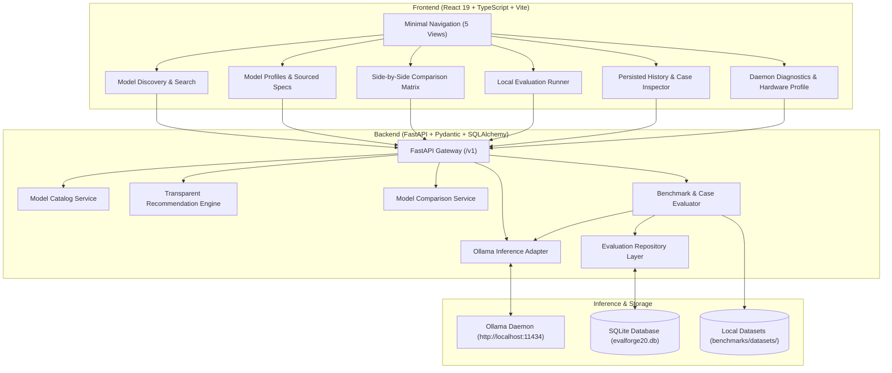

# EvalForge20 — Local-First LLM Model Intelligence & Evaluation Platform

[](https://github.com/reddy895/EvalForge20/actions)
[](https://opensource.org/licenses/MIT)
[](https://python.org)
[](https://fastapi.tiangolo.com)
[](https://react.dev)
[](https://ollama.com)

> **Which AI model is best for my task, and what evidence supports that recommendation?**

EvalForge20 is a local-first model intelligence and evaluation platform designed for AI engineers, researchers, and developers. It replaces speculative marketing claims with measured benchmark evidence, transparent task-specific recommendations, and reproducible local evaluations powered by [Ollama](https://ollama.com).

---

## Architecture Overview



---

## What Makes EvalForge20 Different

1. **Local-First & Offline Resilience**: No mandatory cloud accounts or API keys. If your machine is disconnected, the platform continues to browse cached metadata, view stored runs, and run deterministic mock evaluations.
2. **Evidence-Based Recommendations**: Answers questions like *"Which model is best for coding on 16GB RAM?"* with transparent weighted scores, cited technical reports, and documented trade-offs.
3. **No Synthetic Benchmarks**: Displays verified published scores (HumanEval, GSM8K, MMLU) with sources and clear distinctions between published numbers and local empirical measurements.
4. **Ollama Integration**: Detects installed models dynamically, checks daemon health, inspects context sizes, and executes evaluations against real local weights.
5. **Deterministic Evaluation**: Tests exact Python function syntax, JSON schema constraints, and numeric reasoning without non-deterministic flakiness.

---

## Tech Stack

| Layer | Technology | Key Capabilities |
| :--- | :--- | :--- |
| **Frontend** | React 19, TypeScript, Vite | Fast HMR, minimal navigation, Graphite & Burnt Orange aesthetic |
| **Backend** | Python 3.11+, FastAPI, Pydantic v2 | High-performance async routing, typed schemas, CORS isolation |
| **Database** | SQLAlchemy 2.0, SQLite | Embedded persistence with migration-ready relational schema |
| **Inference** | Ollama Engine | Direct local inference via `http://localhost:11434` |
| **Testing** | Pytest, Vitest, Testing Library | End-to-end integration tests, unit verification, CI automations |

---

## Directory Structure

```text
EvalForge20/
├── frontend/
│   ├── public/
│   ├── src/
│   │   ├── app/                    # App shell, routing, minimal navigation
│   │   ├── components/             # Reusable UI primitives (Button, Badge, Modal)
│   │   ├── features/
│   │   │   ├── catalog/            # Discovery, search, filters, recommendation modal
│   │   │   ├── model-profile/      # Comprehensive sourced model profiles
│   │   │   ├── comparison/         # 2-4 model side-by-side technical matrix
│   │   │   ├── evaluations/        # Local runner & audit history inspector
│   │   │   └── settings/           # Ollama diagnostics & hardware profile
│   │   ├── services/               # Centralized typed API client
│   │   ├── types/                  # Shared TypeScript interfaces
│   │   └── styles/                 # Graphite & Burnt Orange design tokens
│   ├── package.json
│   └── vite.config.ts
├── backend/
│   ├── app/
│   │   ├── api/routes/             # Modular versioned routes (/v1/models, /v1/evaluations...)
│   │   ├── core/                   # Config, structured logging, typed errors
│   │   ├── db/                     # SQLite engine, sessions, schema init
│   │   ├── evaluators/             # ExactMatch, NormalizedMatch, JsonValidity
│   │   ├── models/                 # SQLAlchemy ORM entities
│   │   ├── repositories/           # Data access repository layer
│   │   ├── schemas/                # Pydantic validation schemas
│   │   ├── services/               # ModelCatalog, OllamaService, Recommendations
│   │   └── tests/                  # Backend unit & integration test suite
│   ├── requirements.txt
│   └── .env.example
├── benchmarks/
│   ├── datasets/                   # Test case suites (coding, JSON, reasoning)
│   ├── tasks/                      # Declarative task definitions
│   └── README.md
├── tests/                          # Root integration & end-to-end tests
├── Makefile                        # Unified build, test, and run workflow
└── README.md
```

---

## Quickstart & Installation

### Prerequisites
- Python 3.11+
- Node.js 20+
- (Optional for live inference) [Ollama](https://ollama.com) installed and running

### 1. Clone the Repository
```bash
git clone https://github.com/reddy895/EvalForge20.git
cd EvalForge20
```

### 2. Quick Setup via Makefile
```bash
# Install both backend and frontend dependencies
make install

# Run all automated tests
make test
```

### 3. Start the Backend (Port 8000)
```bash
make dev-backend
# Or directly:
python3 -m uvicorn backend.app.main:app --host 127.0.0.1 --port 8000 --reload
```
API documentation is available at `http://localhost:8000/docs`.

### 4. Start the Frontend (Port 5173)
```bash
make dev-frontend
# Or directly:
cd frontend && npm run dev
```
Open `http://localhost:5173` in your browser.

---

## Ollama Setup & Local Inference

1. **Install Ollama**:
   ```bash
   curl -fsSL https://ollama.com/install.sh | sh
   ```
2. **Start the daemon**:
   ```bash
   ollama serve
   ```
3. **Pull models**:
   ```bash
   ollama pull qwen2.5:3b
   ollama pull llama3.2:3b
   ```
4. **Offline Mode**: If Ollama is not running, EvalForge20 automatically switches to offline mode. You can still browse the full catalog, view stored evaluations, and run benchmarks using the built-in `deterministic-mock-v1` target.

---

## How Evaluations Work

1. **Select Model**: Choose an installed Ollama model (e.g. `llama3.2:3b`) or the deterministic test target.
2. **Select Task**: Choose from:
   - `Python Function Syntheses` (`coding_basics`): Syntax and algorithmic correctness.
   - `JSON Schema & Extraction` (`structured_json`): Valid JSON output with required keys.
   - `Mathematical Reasoning` (`reasoning_math`): Multi-step arithmetic verification.
3. **Execute**: The backend runs the evaluation, measures latency per case, executes deterministic assertions, and persists the result to SQLite.
4. **Inspect**: Examine individual prompts, expected values, actual outputs, and pass/fail statuses in the Case Assertions table.

---

## Recommendation Engine

EvalForge20 maps user tasks to multi-dimensional criteria:
- **Coding**: HumanEval Pass@1, tool-calling reliability, structured output, memory fit.
- **Reasoning**: GSM8K score, MMLU score, context length.
- **Hardware Constraints**: Compares user RAM/VRAM against required memory footprints (4-bit quantized GGUF execution).

Recommendations provide transparent scores (0–100), key evidence citations, and trade-off summaries.

---

## Testing

```bash
# Backend pytest suite (23 tests)
pytest tests/ backend/app/tests/ -v

# Frontend vitest suite (20 tests)
cd frontend && npm test

# Frontend production bundle compilation
cd frontend && npm run build
```

---

## License

MIT License. See [LICENSE](LICENSE) for details.
